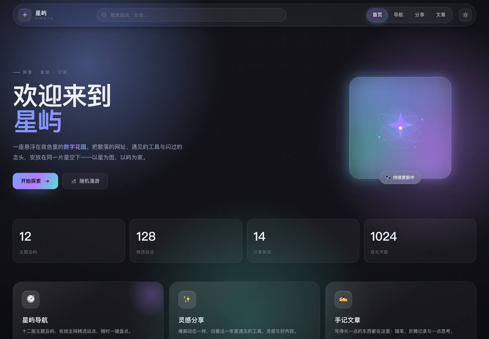
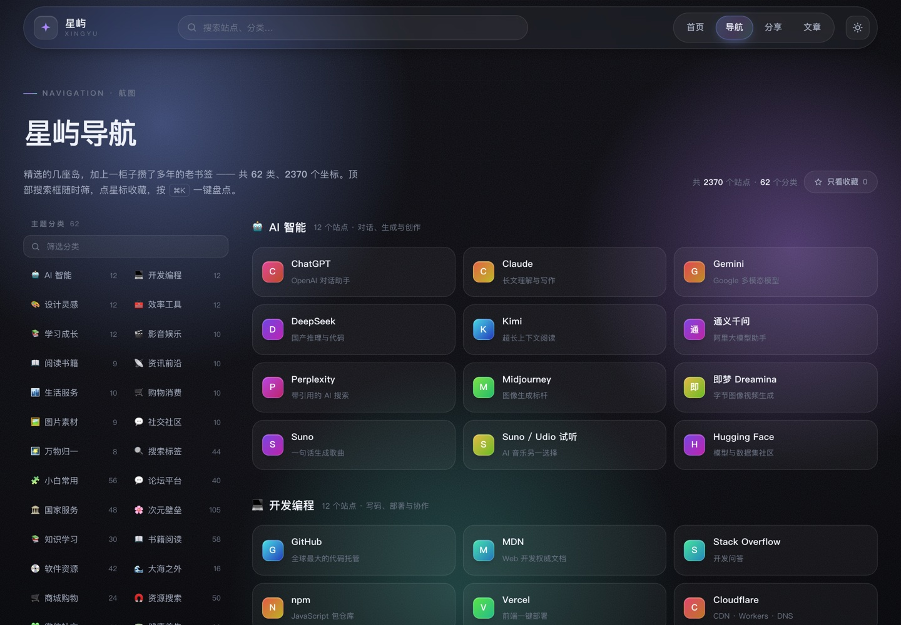
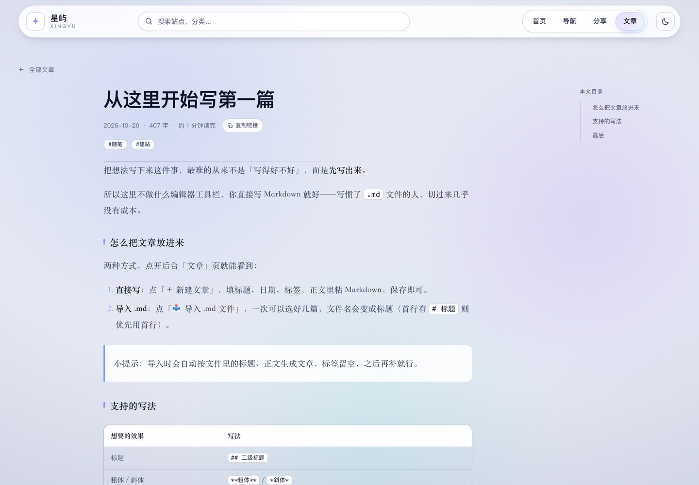
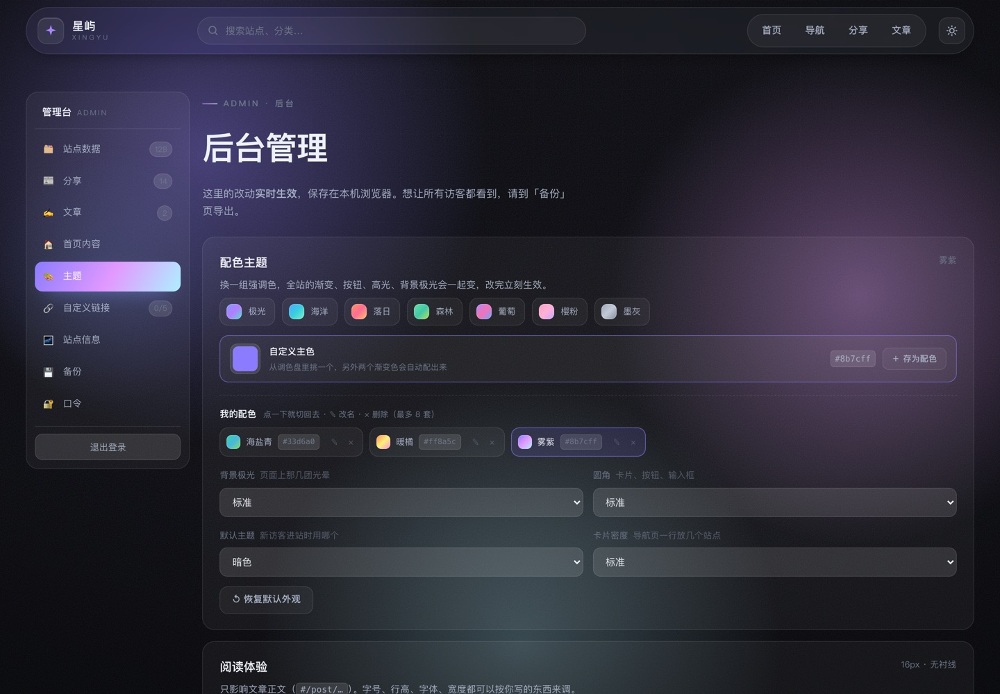
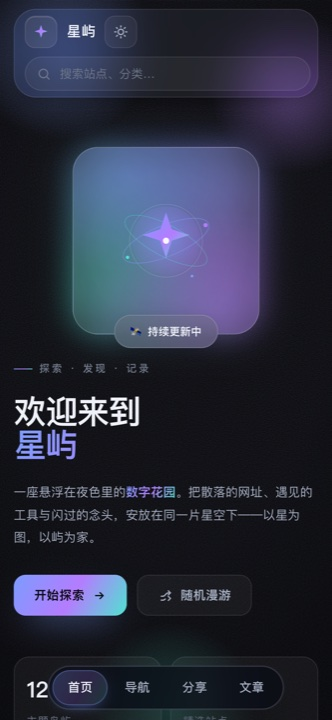
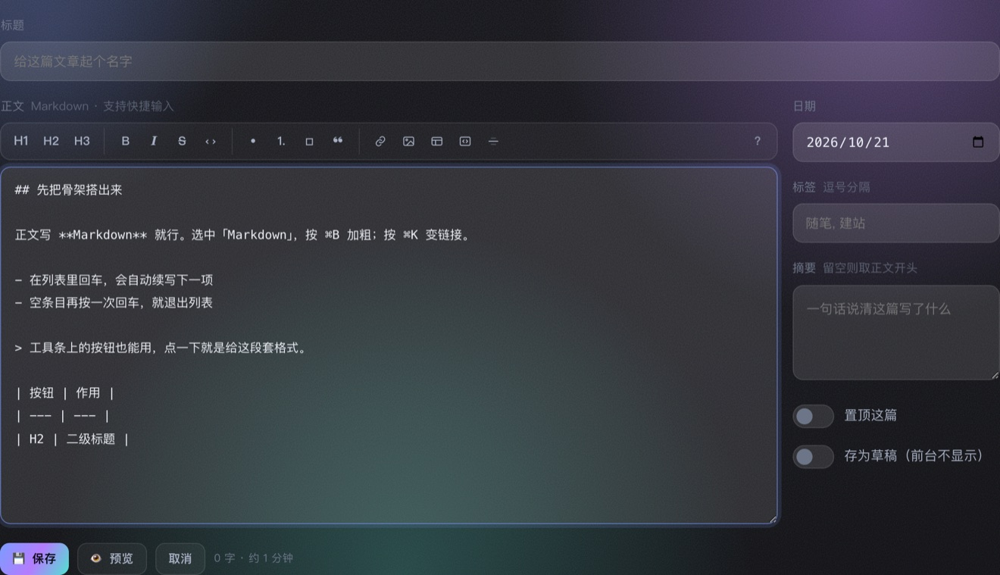
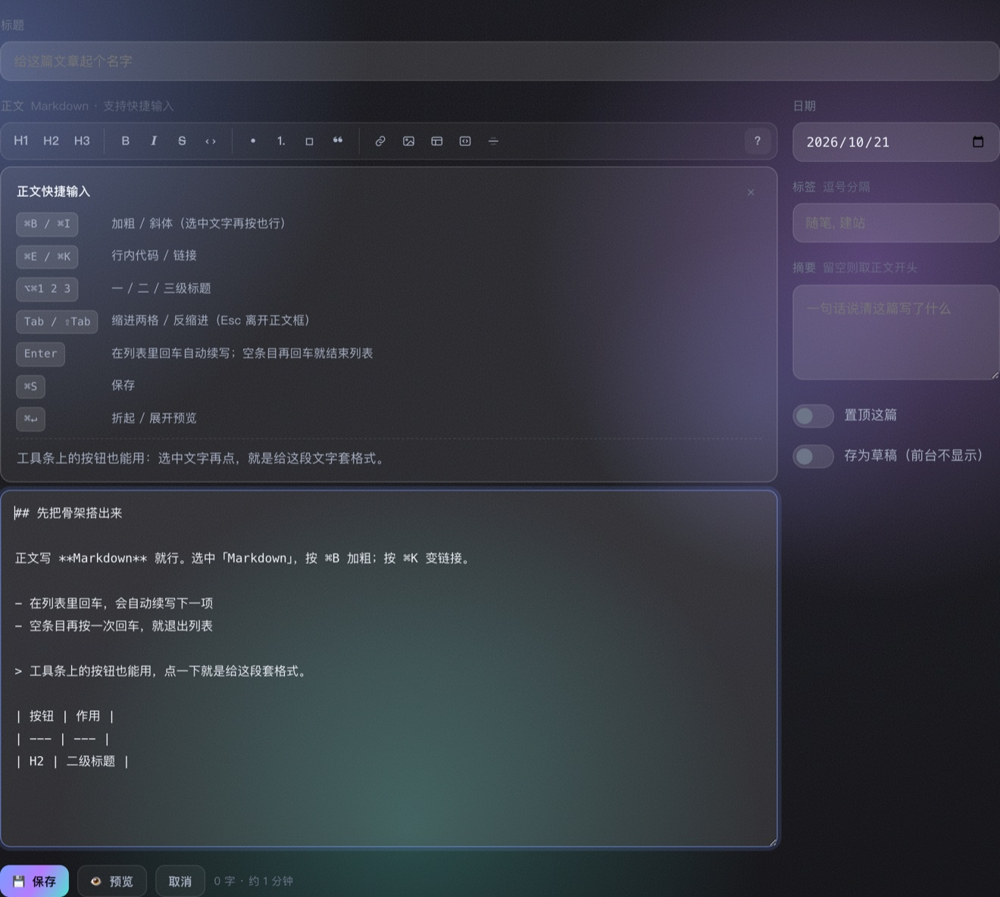
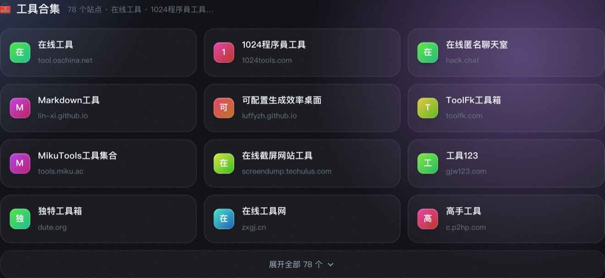

# 星屿 XingYu

一座悬浮在夜色里的个人数字花园 —— **导航 · 分享 · 文章 · 首页** 四合一的纯前端单页应用。

> 以星为图，以屿为家。

设计上参考了同类个人站（如 `yihaozhan.xyz`）"导航 + 讯息流 + 首页"的结构，
但视觉、交互与内容均为原创：**暗色玻璃拟态 + 极光背景 + 命令面板**。

## 界面预览

| 首页 · 一屏装下所有入口 | 导航 · 50 个分类 / 2078 个站点 |
| :---: | :---: |
|  |  |

| 分享 · 按日期排的时间线 | 文章正文 · 明亮 + 衬线排版 |
| :---: | :---: |
|  |  |

| 后台 · 主题与配色（含「我的配色」） | 手机端 |
| :---: | :---: |
|  |  |

> 所有界面都能在后台实时改：**配色、圆角、字号、行高、字体、正文宽度**都是变量，改完立刻生效，不用构建也不用刷新。

---

## 快速开始

无需构建、无依赖，两种打开方式任选：

```bash
# 方式一：直接双击 index.html（file:// 即可运行）

# 方式二：本地起服务（推荐，localStorage 收藏功能可正常持久化）
python3 -m http.server 8321
# 然后访问 http://127.0.0.1:8321
```

### 版本管理

仓库已经用 git 管着（`.gitignore` 忽略了 macOS 在 exFAT 盘上生成的 `._*` 副产物）。
改代码前先存一次锚点，改坏了随时能回：

```bash
git add -A && git commit -m "这次改了什么"
git diff          # 看自己改了什么
git checkout -- . # 放弃还没提交的改动
```

## 目录结构

```
├── index.html              # 应用外壳（顶栏含全局搜索 + 自定义链接 / 手机端底部 tab 栏 / 页脚 / ⌘K 命令面板 / 快捷键面板）
├── manifest.webmanifest    # PWA 清单：装到手机主屏时的名称、图标、启动页
├── sw.js                   # Service Worker：离线缓存（版本号要和 index.html 的 ?v= 一起改）
├── feed.xml                # RSS 订阅源（由 tools/gen-feed.js 生成，别手改）
├── tools/gen-feed.js       # 改完「分享」或「文章」后跑一下，重新生成 feed.xml
├── tools/import-naver.py   # 把「壹号导航」naver.html 里的书签抽成 bookmarks.js（见下文「搬老书签进来」）
├── tools/check-links.py    # 并发探测全部链接死活（直连 + 代理复验），输出死链清单
├── tools/dead-links.txt    # 死链清单（check-links.py 生成，import-naver.py 生成时会跳过）
├── docs/screenshots/       # README 里那几张界面预览图（换了外观想更新配图就照着重拍）
└── assets
    ├── og-cover.png        # 分享卡片封面（1200×630，微信/微博/iMessage 抓这张）
    ├── icon-180.png        # iOS 添加到主屏的图标（180×180）
    ├── icon-192.png        # PWA 图标
    ├── icon-512.png        # PWA 图标（同时用作 maskable）
    ├── css/style.css       # 全部样式：设计变量、玻璃组件、后台、响应式
    └── js
        ├── config.js       # ★ 配置层：站名/标语/建站日期/主题配色/阅读排版/导航页显示开关/卡片密度/首页文案与图片/Logo/自定义链接/文章读写
        ├── bookmarks.js    # 导航数据：50 个分类 / 2078 条链接（自动生成，别手改）
        ├── data.js         # ★ 数据层：导航站点、分享流、首页入口卡片、文章（改这里就够）
        ├── md.js           # 手写的零依赖 Markdown 渲染器（文章正文用）
        ├── app.js          # 逻辑：hash 路由、渲染、搜索、收藏、主题、滑动
        └── admin.js        # 后台管理面板（#/admin）
```

## 后台管理（`#/admin`）

页脚点 **⚙︎ 后台管理**，或直接访问 `#/admin`。默认口令 **`xingyu`**，进去后可在「口令」页修改。
纯前端实现（无服务器）：改动**实时生效**并保存在浏览器 `localStorage`，只有你自己看得到。
后台是**左右布局**——左侧常驻导航（带数据角标）+ 右侧内容区，整体全宽铺满；
窄屏（≤960px）时左侧导航自动变成顶部横向标签条。

| 标签页 | 能做什么 |
| --- | --- |
| **站点数据** | 管理导航页的**全部分类与站点**（也就是全站搜索的数据源）：新增/重命名/删除分类、增删改站点，**按住每行左侧的握把就能拖动排序**（鼠标 / 触屏都行，长列表拖到边缘会自动滚动），支持按名称/网址/描述**搜索过滤**；每个站点右侧的 **📌** 可以置顶（置顶的排在分类最前面）。**「📥 导入书签」** 可以直接吃 Chrome / Edge / Firefox / Safari 导出的书签 HTML，按文件夹自动分类、自动去重。展开的分类会**独占一整行**，站点列表内部滚动 + 吸底「添加站点」，几百个站点也不会把页面撑长 |
| **分享** | 前台「分享」页时间线的全部内容：**新增 / 编辑 / 删除 / 搜索**，字段是日期、图标（🙂 挑 emoji）、标题、链接、描述、标签；编辑器里**边打字边看前台卡片长什么样**。列表按日期倒序（同一天并排），删之前要点两下确认 |
| **文章** | 写长文的地方：列表里带**搜索 / 置顶 📌 / 查看 / 两步删除**，点「＋ 新建文章」进编辑器（标题 / 正文 / 日期 / 标签 / 摘要 / 置顶 / 草稿），正文是 **Markdown**，上方一条**快捷输入工具条**（加粗 / 标题 / 列表 / 链接 / 表格…，配 `⌘B`、`⌘K`、`Tab` 缩进等快捷键，详见「写文章」一节），右侧实时字数与预计阅读时长，**👁 预览** 就地看排版效果。**点保存就收起编辑器回到列表**，刚存的那篇会高亮闪一下。**「📥 导入 .md」** 可一次多选本地 Markdown 文件进来（详见下一节）。存了**草稿**的不会出现在前台列表 |
| **首页内容** | 编辑首页的一切：首屏**文字**（小标签 / 两行主标题 / 描述前后半句 / **轮换词**）、**首屏图片**（上传自己的照片或填图片网址，可设铺满或完整显示）、两个**按钮**文字与链接、图片上的小徽章、**数字统计**（自动统计分类数/站点数/分享数/成长天数，或自己填数字，可拖动排序）、**快捷入口卡片**（增删改、图标、拖动排序、星光）、**今日精选**（标题 / 副标题 / 显示条数）。每项都能单独恢复默认 |
| **主题** | **配色 / 阅读**自定义（详见下面「主题与阅读」）：7 套预设配色 + 任意自定义主色 + **「我的配色」存多套随时切回**、背景极光强度、圆角大小、默认主题、卡片密度；还有文章页的**字号 / 行高 / 字体 / 正文宽度 / 右侧目录**。旁边就是**实时预览**，改一下马上能看到效果 |
| 自定义链接 | 添加自己想放的链接，**最多 5 个**（图标 + 名称 + 链接），**可拖动排序**、可删除，显示在顶栏搜索框右侧，全站常驻。**图标是可选的**：填一个 emoji（如 🐙 📚 🎧）即可，后台点 🙂 可直接挑；**留空则只显示文字名称** |
| 站点信息 | 改站名、拉丁名、标语、**建站日期**（首页「成长天数」从这天开始数，日历里直接选）、**顶栏 Logo 图片**、**浏览器标签图标 Favicon**、顶栏搜索框显隐；还有导航页的**三个显示开关 —— 卡片图标 / 卡片介绍（域名）/ 分类图标**，三项**默认全关**，导航页只剩名字，一行能看更多站点 |
| 备份 | **一键下载备份文件**（含站点数据 + 站点设置 + 首页内容 + 自定义链接 + 分享 + 文章 + 图片）、**从备份文件恢复**（选文件 → 弹确认 → 覆盖）、**云备份到 GitHub Gist**（上传 / 从云端恢复 / 断开，还会带上收藏与最近访问）、**恢复默认设置 / 恢复默认数据 / 恢复默认分享 / 恢复默认文章**（都会先弹确认框）。页面上不再出现任何 JSON / 代码框 |
| 口令 | 修改访问口令 |

### 换图片

后台能换三处图片，都是**「📁 上传图片」或「填图片网址」二选一**，想反悔点「↺ 用回默认」：

| 位置 | 在哪改 | 建议尺寸 |
| --- | --- | --- |
| **首页右侧大图** | 「首页内容」→ 首屏图片 | 方图最好看（1:1）；会自动压到 1100px 以内 |
| **顶栏 Logo** | 「站点信息」→ 顶栏 Logo | 正方形 PNG，建议透明或深色背景 |
| **浏览器标签图标** | 「站点信息」→ Favicon | 64×64 方形 PNG / SVG / ICO |

> 上传的图片会被**自动压缩**（长边缩到 1100px、转成 JPEG）后再存进浏览器，
> 所以不用担心手机拍的大图拖慢打开速度。图片是存在本机的，想换电脑就把它一起放进备份文件里（备份会自动包含图片）。

> 站点数据全部来自 `assets/js/bookmarks.js`（50 个分类 / 2078 个站点，由 `tools/import-naver.py` 生成），
> `data.js` 只负责把它接起来；在后台改过之后就会以你的版本为准（存在本机），
> 点「恢复默认数据」即可还原成 `bookmarks.js` 里的内容（会先弹确认框）。
>
> **备份页怎么用**：点「⬇ 下载备份文件」得到一个 `xingyu-backup-日期.json`；
> 换电脑或想还原时点「📂 选择备份文件」选中它，确认一下就恢复了。
> 所有破坏性操作（恢复备份 / 恢复默认设置 / 恢复默认数据）都会先弹确认框。

### 让改动对所有访客生效

后台里的改动只存在**你自己的浏览器**。要让所有访客看到，用「备份」页最下面的
**「进阶：让改动对所有访客生效」**（默认收起）——里面两个按钮会把内容复制到剪贴板，
粘进源码即可：

**站点设置** → 点「复制站点设置」，粘到 `index.html` 的 `<script src="assets/js/config.js">` **之前**：

```html
<script>window.XY_CONFIG = {
  "siteName": "星屿",
  "tagline": "以星为图，以屿为家",
  "logoImage": "",
  "customLinks": [ { "icon": "🐙", "name": "GitHub", "url": "github.com" } ],
  "home": { "eyebrow": "探索 · 发现 · 记录", "titleMain": "星屿" }
};</script>
```

> 首页文案、Logo、Favicon 都在**站点设置**里，一起复制粘贴就好。
> 图片如果很大，`XY_CONFIG` 会变得很长——这种情况下更推荐直接在
> 「首页内容」里换图（本机生效），或用备份文件搬家。

**站点数据** → 点「复制站点数据」，替换 `data.js` 里的 `categories` 数组即可。

优先级：`XY_CONFIG` / `data.js`（写死，永久）→ `localStorage`（后台改的，仅本机）→ 内置默认值。

## 主题与阅读（自定义外观）

`#/admin` →「**主题**」。上半张卡管**颜色**，下半张卡管**读起来累不累**，改完立刻生效、不用刷新，旁边就是实时预览。

### 配色

| 能改什么 | 选项 |
| --- | --- |
| **配色** | 7 套预设：极光（默认）/ 海洋 / 落日 / 森林 / 葡萄 / 樱粉 / 墨灰；也可以**自己挑一个主色** |
| **我的配色** | 自己挑的颜色可以**存成一套**（配色 A / B / C…，最多 8 套），以后一键切回；支持改名、删除 |
| **背景极光** | 强 · 气氛更足 / 标准 / 关掉 · 更干净 |
| **圆角** | 小 · 干练 / 标准 / 大 · 圆润 |
| **默认主题** | 暗色 / 明亮（新访客进站时用哪个；右上角月亮按钮仍可随时切） |
| **卡片密度** | 紧凑 / 标准 / 宽松（导航页一行放几个站点） |

- 自定义主色只要挑**一个**颜色，另外两个渐变色会按色相自动推（+36° / −56°），所以随便挑也不会出现「脏渐变」
- 配色一变，**按钮、链接、徽标、滚动进度条、选中文字、背景极光、发光描边**会一起换掉，不是只换个点缀
- 改乱了点「↺ 恢复默认外观」，一键回到极光 + 标准光晕 + 标准圆角。**「我的配色」不会被清掉**——那是你的存货，不是当前外观

#### 我的配色（存多套随时切回）

调好一个自定义主色后，点右边的「**＋ 存为配色**」，它就会出现在下面那一排：

| 操作 | 怎么做 |
| --- | --- |
| 切回某一套 | 点它一下（色点 + 名字），全站立刻换过去 |
| 改名 | 点 ✎，直接改，**回车**保存 / **Esc** 放弃 |
| 删除 | 点 ×，确认一下。删的只是这套存货，**当前页面的颜色不会变** |
| 存不下 | 最多 8 套，存满后按钮会变灰，先删一套再存 |
| 同一个颜色 | 已经存过的颜色会被挡下来并提示是哪一套，不会出现两个一样的 |

切到内置色板（比如「落日」）时，「自定义主色」会跟着同步成那个色板的主色——所以你紧接着点「存为配色」，存下的就是你**眼下看到的颜色**，不会是上一次的旧色。

### 阅读

只影响文章正文（`#/post/<id>`），让长文读起来更舒服：

| 项 | 选项 | 默认 |
| --- | --- | --- |
| 正文字号 | 14 – 20 px 滑杆 | 16 px |
| 行高 | 紧凑 1.6 / 标准 1.75 / 舒展 1.95 / 宽松 2.1 | 1.95 |
| 字体 | 系统无衬线（清晰）/ 衬线（更像纸书） | 无衬线 |
| 正文宽度 | 窄 680 / 偏窄 760 / 标准 820 / 偏宽 900 / 宽 980 | 820 |
| 右侧目录 | 开 / 关（标题 ≥3 个且宽屏时才出现；关掉后正文自动居中占满） | 开 |

> 手机上字号会自动小半号，长行也会自动收窄，不用担心调大了在手机上一行只放几个字。

### 存在哪

- 存在 `xingyu.config.v1` 的 `theme` / `read` 两段，和别的后台设置一样**只在你本机**
- **下载备份 / Gist 云备份都会带上**（设置整包一起走），换设备恢复就还原，「我的配色」也在里面
- 想让**所有访客**都看到同样的配色与排版：把设置写进 `index.html` 里 `config.js` 之前的 `window.XY_CONFIG`，例如
  ```js
  window.XY_CONFIG = {
    theme: { accent: 'sunset', glow: 'normal', radius: 'large' },
    read:  { size: 17, line: 1.9, font: 'serif', width: 760, toc: true }
  };
  ```
  「我的配色」也能这样预置给别人（每套就是名字 + 一个主色）：
  ```js
  theme: {
    accent: 'custom', accentColor: '#33d6a0',
    presets: [
      { name: '海盐青', color: '#33d6a0' },
      { name: '暖橘',   color: '#ff8a5c' }
    ]
  }
  ```

## 发一条分享（`#/share`）

「分享」页那条时间线也在后台管：`#/admin` →「**分享**」（左侧第二个标签）。

- 点 **＋ 新增分享** 就能加一条，字段：**日期 / 图标 / 标题 / 链接 / 描述 / 标签**
- 编辑器右侧就是**前台卡片的样子**，边打字边变，不用保存才能看效果
- 链接可以填站外网址，也可以填站内页面（`#/nav`、`#/post`、`#/post/文章id`）——站内的不会新开窗口，也不显示 ↗
- **标签**用逗号分隔，会变成分享页顶部的筛选胶囊（右侧还会显示每个标签有几条）
- 列表按**日期倒序**排，同一天的几条在前台会**并排成 2～3 列**；删除要**点两下**确认
- 存在 `localStorage` 的 `xingyu.feed.v1`，**下载备份 / Gist 云备份都会带上**（备份格式 `version: 4`），备份页还有独立的「恢复默认分享」
- 想让**所有访客**都看到，把内容写进 `assets/js/data.js` 的 `feed`（`feed.xml` 也是从那里生成的，改完跑一次 `node tools/gen-feed.js`）

## 写文章（Markdown）

顶栏第 3 个入口是 **文章**（手机端在底部 tab 栏），对应 `#/post`；
点进某篇就是阅读页 `#/post/<文章id>`。文章都写在 **Markdown** 里，渲染器是手写的（`assets/js/md.js`，零依赖）。

| 页面 | 有什么 |
| --- | --- |
| `#/post` 列表 | 按**年份分组**、标签筛选（右侧实时显示条数）、📌 置顶排最前、两行摘要、字数与预计阅读时长；**大屏一行排 2–3 篇**（窄屏一篇一行）；顶部数字是「篇数 / 总字数 / 标签数」 |
| `#/post/<id>` 阅读 | 正文排版（标题、代码块、表格、任务清单、引用都有针对性样式）、**右侧悬浮目录**（宽屏且标题 ≥3 个才出现，点一下平滑跳转）、上一篇 / 下一篇、一键复制链接 |

**写一篇的三种方式：**

1. `#/admin` →「**文章**」→ **＋ 新建文章** —— 标题 / 正文 / 日期 / 标签 / 摘要 / 置顶 / 草稿都在一个页面里，右边实时显示字数和阅读时长，**👁 预览** 就地看排版
2. `#/admin` →「**文章**」→ **📥 导入 .md**（可一次多选）—— 直接把本地 `.md` 文件丢进来
3. 直接改 `assets/js/data.js` 里的 `posts` 数组（对所有访客永久生效）

### 正文支持快捷输入

新建 / 编辑文章的正文框上方有一条工具条，**选中文字再点按钮 = 给这段套格式**，再点一次就取消：

| 工具条 · 选中文字点一下套格式 | 最右边的 **?** · 快捷键一览 |
| :---: | :---: |
|  |  |

| 想做什么 | 工具条 | 快捷键 |
| --- | --- | --- |
| 加粗 / 斜体 / 删除线 | **B** / *I* / ~~S~~ | `⌘B` / `⌘I` / — |
| 行内代码 | `‹›` | `⌘E` |
| 一 / 二 / 三级标题 | H1 H2 H3 | `⌥⌘1` `⌥⌘2` `⌥⌘3` |
| 无序 / 有序 / 待办清单 | • / 1. / ☐ | — |
| 引用 | ❝ | — |
| 链接 / 图片 | 链接、图片两个小图标 | `⌘K` / — |
| 表格 / 代码块 / 分割线 | 最后三个小图标 | — |
| 缩进 / 反缩进两格 | — | `Tab` / `⇧Tab` |
| 保存 / 预览 | 💾 / 👁 | `⌘S` / `⌘↵` |

- **在列表里回车会自动续写下一项**（`1.` 还会自动 +1）；空条目再按回车就退出列表
- 什么都没选中时点加粗，会先塞一段占位文字并选中它，直接打字就替换掉
- 插入走的是浏览器原生编辑，所以 `⌘Z` 能一路撤销回去
- 工具条最右边的 **?** 随时能看这张表，点别处收起
- 在 macOS 上是 `⌘`，Windows / Linux 自动显示成 `Ctrl+`

**导入 .md 时的规则（按这个优先级自动取值）：**

| 字段 | 优先级 |
| --- | --- |
| 标题 | front-matter 的 `title` → 正文第一个 `# 标题` → 文件名 |
| 日期 | front-matter 的 `date` → 文件名开头的 `2026-09-01` → 文件的修改时间 |
| 标签 | front-matter 的 `tags`（逗号 / 顿号 / `#` 都认），最多 8 个 |
| 摘要 | front-matter 的 `excerpt`，没写就自动从正文里截前 160 字（会先去掉表格、代码块这些） |

文件开头可以放一段 front-matter，也可以完全不放：

```markdown
---
title: 文件名里的标题会被这个覆盖
date: 2026-10-20
tags: [随笔, 折腾, 设计]
excerpt: 列表里显示的那句摘要，不写就自动截。
---

正文从这里开始……
```

文件名也能带日期，两个都会认：`2026-09-01-我的文章.md` → 标题「我的文章」+ 日期 `2026-09-01`。

**支持的语法**（写文章够用，超出的不解析、原样显示）：

`#` ~ `######` 标题（页面内自动降一级，给文章大标题留位置）、**粗体**、*斜体*、~~删除线~~、
`行内代码`、``` 代码块（带语言标记会在左上角显示语言名）、[链接](url)、、
有序 / 无序列表（支持缩进嵌套、`- [ ]` 任务清单）、`>` 引用、`---` 分隔线、`| 表格 |`（支持 `:---:` 对齐）、裸网址自动变链接。

> 安全：渲染是**先转义 HTML 再拼标签**的，`javascript:` / `data:` 这类链接一律拦掉，
> 粘进来别人的 Markdown 也不会带进脚本。

**存在哪、怎么备份：**

- 文章存 `localStorage` 的 `xingyu.posts.v1`，和其他后台改动一样**只在你本机**；想让访客都看到，就写进 `data.js` 的 `posts`
- **下载备份文件 / GitHub Gist 云备份都已包含文章**（备份格式升到 `version: 3`），换设备能整包搬过去
- 备份页还有一个独立的 **「恢复默认文章」**，只清文章、不动站点数据
- `feed.xml` 也会带上最新文章（标题前有 📝），改完文章跑一次 `node tools/gen-feed.js`
- 标了**草稿**的文章：后台列表里带「草稿」角标，前台列表、搜索、命令面板、RSS 里都不会出现
- `data.js` 里自带**两篇示例**（「从这里开始写第一篇」和「星屿是怎么搭起来的」），看完可以直接删

## 把浏览器书签搬进来

不用一条条手填。先在浏览器里导出书签：

| 浏览器 | 怎么导出 |
| --- | --- |
| Chrome / Edge | 书签管理器（⌥⌘B）→ 右上角 ⋮ → **导出书签** → 存成 `.html` |
| Firefox | 书签管理（⇧⌘O）→ 导入和备份 → **导出书签到 HTML** |
| Safari | 文件 → 导出 → **书签** |

然后回到 `#/admin` →「站点数据」→ **📥 导入书签** → 选中那个 HTML 文件。

- 每个**文件夹**会变成一个**分类**；直接放在书签栏根上的会进「未分类」
- **同名分类会自动合并**，不会覆盖你已有的站点
- 已经在导航里的站点（按网址比对，忽略结尾的 `/`）会**自动跳过**，不会重复
- `javascript:` 之类的小书签会被忽略
- 导入前会先弹一个确认框告诉你：**几个分类、几个站点、跳过几个**

> 导入的内容和其他后台改动一样只存在本机。想让访客也看到，用「备份」页的「复制站点数据」写回 `data.js`。

### 从另一个导航站整站搬（naver.html）

「壹号导航」那种整页都是链接的站，可以直接抽取，不用手抄：

```bash
# 1. 抓下那一页（它不在本地也没关系）
curl -o /tmp/naver.html http://yihaozhan.xyz/naver.html

# 2. 抽成 assets/js/bookmarks.js
python3 tools/import-naver.py /tmp/naver.html
```

脚本认的是 `<section id="section-N">` 里的 `.category-title` 与 `.category-link`，规则如下：

| 情况 | 怎么处理 |
| --- | --- |
| 站内相对链接（`qiantai.html`、`suishouji/index.html`） | 补成 `http://yihaozhan.xyz/…` 的绝对地址 |
| 同一个分类里重复出现的网址 | 只留第一条（这一轮去掉了 33 条重复） |
| 同一个站出现在不同分类 | **保留** —— 一个站同时属于「搜索」和「常用」很正常 |
| 分类 id | 统一加 `bk-` 前缀，以后自己另加分类也不会撞车 |
| 分类描述 | 自动取该类前两个站名（如「Google · DeepSeek…」） |

生成完 `bookmarks.js` 会被 `data.js` 接在精选分类后面（没有这个文件也不会报错）。想调分类名和 emoji，改脚本顶部的 `META` 表再跑一次。

**死链检测（可选，但强烈建议搬完跑一次）**：老书签里有不少站早就关了。用 `tools/check-links.py` 过一遍：

```bash
# 先直连探测，失败的自动走本地代理复验（区分「真死」和「被墙」）
python3 tools/check-links.py --proxy http://127.0.0.1:7897
```

结果写进 `tools/dead-links.txt`，再跑一次 `import-naver.py` 就会自动跳过这些网址。
判定偏保守：只有 **404 / 410 / 域名解析不了 / 连接被拒** 才算死；403、429、5xx、超时一律保留。

> 50 个分类一次全铺出来是两万多个节点。导航页**不做折叠**——进去就是把所有站点全列出来，
> 靠 CSS 的 `content-visibility:auto` 让视口外的分类块跳过布局与绘制（相当于浏览器自带的
> 虚拟滚动），配合 `contain-intrinsic-size:auto` 记住每块真实高度、滚动条长度不跳。
> 实测 4 倍 CPU 降速下滚动 p95 帧间隔 26ms，不会因为"全都摊开"而发涩。



## 多设备同步（GitHub Gist）

后台 →「备份」→「云备份 · GitHub Gist」。把站点数据、设置、**收藏**和**最近访问**存进你 GitHub 账号下一个**私有 Gist**，换电脑或换浏览器时点「从云端恢复」就全回来了。

1. 打开 <https://github.com/settings/tokens> → Generate new token (**classic**) → 只勾 **`gist`** → 生成
2. 把 Token 粘进后台那个框 → 点 **⬆ 上传到云端**（第一次会自动新建私有 Gist）
3. 之后每次改动再点一次上传即可；换设备时填同一个 Token 就能「从云端恢复」

> Token 只存在你这台浏览器的 `localStorage`，只发往 `api.github.com`。
> 公用电脑上用完点「断开」。Gist 里是明文 JSON，介意的话就别放敏感内容。

## 装到手机主屏（PWA）

这是个 PWA —— 打开线上地址后：

- **iPhone**：Safari → 分享 → **添加到主屏幕**
- **Android**：Chrome → 右上角 ⋮ → **添加到主屏幕 / 安装应用**

装完就是个独立图标，打开没有浏览器地址栏，**断网也能看已经访问过的内容**（`sw.js` 缓存了页面和资源）。

> 改版后想让老用户立刻拿到新版：把 `sw.js` 里的 `VERSION` 和 `index.html` 里所有 `?v=` 一起 +1。
> 页面本身是「网络优先」，所以刷新就能看到新内容，不会卡在旧版。

## 订阅（RSS）

`feed.xml` 是「分享 + 文章」的订阅源，页脚有 **📡 RSS** 入口，任何阅读器（Feedly / Inoreader / Reeder…）都能订阅。

```bash
# 改了 data.js 里的 feed / posts 之后，重新生成一次
node tools/gen-feed.js
# 换域名了就带上新地址
node tools/gen-feed.js https://your-domain.com/
```

> 静态站点没有后端，订阅源是**构建产物**：改完分享条目要记得重新跑一次脚本，否则订阅里看不到新内容。
> 已自动处理：按日期倒序、取最新 20 条、站内 `#/nav` 这类相对链接补成完整网址。

## 分享卡片与 SEO

`index.html` 的 `<head>` 里已经备好一整套分享卡片标签（Open Graph + Twitter Card）：

> ✅ **线上地址：<https://mackxin.github.io/xingyu/>**（GitHub Pages，推 `main` 即自动发布）

| 文件 | 用在哪 |
| --- | --- |
| `assets/og-cover.png` | 1200×630 的分享封面，微信 / 微博 / iMessage / Slack 转发时显示的图 |
| `assets/icon-180.png` | iOS「添加到主屏幕」的图标 |

> ⚠️ **换域名必做**：`og:image` / `twitter:image` / `apple-touch-icon` 写的是**完整网址**
> （大多数平台只吃绝对路径），现在是 `https://mackxin.github.io/xingyu/...`。
> 换成自己的域名后，把 `index.html` 里这几处前缀一并替换，分享卡片才会出图。
>
> 想换封面：直接替换 `assets/og-cover.png` 这张图（保持 1200×630）即可。

## 部署到自己的域名

纯静态站点，任何静态托管都能放（不需要 Node、不需要构建）。

**当前状态：已部署在 GitHub Pages** —— 仓库 <https://github.com/Mackxin/xingyu>，
Pages 源是 `main` 分支根目录，推上去等几十秒自动更新。

```bash
# 日常更新只做这两步
git add -A && git commit -m "说明这次改了什么"
git push          # 推完约 30 秒线上就变了
```

从零再建一个同样的站（换号 / 换项目时参考）：

```bash
# 0. 前提：装好 gh（本机在 ~/.local/bin/gh）并已登录
export PATH="$HOME/.local/bin:$PATH"

# 1. 建仓库并推上去
gh repo create xingyu --public --source=. --remote=origin --push

# 2. 开 Pages：仓库 → Settings → Pages → Source 选 `main` / `root` → Save
#    或用命令行一次搞定：
gh api -X POST repos/<用户名>/xingyu/pages \
  -f "source[branch]=main" -f "source[path]=/"
```

> 用自定义域名（如 `xingyu.yourdomain.xyz`）时，在仓库根目录加一个 `CNAME` 文件，
> 内容就写域名本身；再去域名商那里加一条 `CNAME` 解析指向 `<用户名>.github.io`。
> 记得同时改掉 `index.html` 里写死的分享图网址。
>
> **注意**：因为用的是 `#/xxx` 形式的 hash 路由，服务器不需要任何 rewrite 规则，
> 刷新任意页面都不会 404 —— 这是静态托管最省心的那种。

### 发版清单（每次改完照着走）

```bash
# 1. 改了「分享」条目或文章，就重新生成订阅源
node tools/gen-feed.js

# 2. 改了 css / js：把 index.html 里的 ?v= 和 sw.js 里的 VERSION 一起 +1
#    （否则老访客的离线缓存可能还拿着旧文件）

# 3. 提交并推送
git add -A && git commit -m "这次改了什么"
git push
```

## 四个页面

| 路由 | 页面 | 说明 |
| --- | --- | --- |
| `#/home`  | 首页 | Hero + 数字滚动统计 + Bento 入口 + 今日精选横轨 |
| `#/nav`   | 导航 | 50 个分类 / 2078 个站点（从「壹号导航」整站搬来，已剔除死链）、**全部默认展开**（视口外的分类靠 `content-visibility` 按需渲染）、分类侧栏（**可筛选 / 手机端可展开**）与滚动联动、收藏 |
| `#/share` | 分享 | 时间线讯息流：标题右侧带概览数字，按日期分组，**同一天多条时并排成 2～3 列**，按标签筛选（窄屏 ≤960px 时标签收进顶栏的**「标签」按钮**，和导航页的分类按钮同一位置，点开是底部标签面板） |
| `#/post`  | 文章 | 自己写的长文：按年份分组、标签筛选、置顶；**大屏一行最多排三篇**（≥1180px 两列、≥1560px 三列）；`#/post/<id>` 是阅读页，带悬浮目录与上一篇 / 下一篇 |

> 布局为**全宽铺满**（`--maxw: none`），内容间距由 `--pad-x` 控制。

## 亮点功能

- **顶部全局搜索 · 搜全站** —— 顶栏那个搜索框现在搜的是**整站内容**：页面、分类、站点、分享、文章全都能搜到。边打字边在框下面弹结果，按类型分组，命中的字高亮；`↑↓` 选、`↵` 打开、`Esc` 收起，点站点新标签打开、点分类直接跳到导航页并定位到那一块。在导航页输入时页面还会同步筛成结果列表，停手后再筛、不打断打字。匹配逻辑与 ⌘K 命令面板共用一套（含拼音首字母，输入 `txsp` 能命中「腾讯视频」），所以两边结果永远一致
- **主题和阅读都能自己调** —— 7 套配色 + 任意自定义主色（另外两色自动配）+ **「我的配色」存 8 套随时切回**、极光强度、圆角、默认主题；文章页的字号 / 行高 / 字体 / 正文宽度 / 右侧目录也能调，后台改完立刻生效，旁边就是实时预览
- **分享条目在后台就能发** —— 「分享」页那条时间线不用碰代码：后台「分享」新增 / 编辑 / 删除 / 搜索，编辑器里直接是前台卡片的样子（边打字边变），标签填好就自动变成页顶的筛选胶囊
- **写自己的文章** —— 顶栏「文章」入口 + 后台 Markdown 编辑器：`.md` 文件一键导入（front-matter / 首个标题 / 文件名自动识别标题与日期），列表按年份分组、按标签筛选，阅读页有悬浮目录和上一篇 / 下一篇；自定义渲染器零依赖、先转义后拼标签，粘别人的 Markdown 也不怕带脚本
- **写文章不用背语法** —— 正文框上方一条工具条（加粗 / 标题 / 列表 / 引用 / 链接 / 表格 / 代码块…），配 `⌘B` `⌘I` `⌘K` `⌘S`、`Tab` 缩进等快捷键；列表里回车自动续写、空条目回车退出，插入操作还能 `⌘Z` 撤销
- **拼音首字母也能搜** —— 中文站名不用切输入法：输 `zh` 命中「知乎」、`txsp` 命中「腾讯视频」、`blbl` 命中「哔哩哔哩」。用的是内置的拼音锚点比对，不联网、不加字库
- **最近访问 / 最常去** —— 点过的站点自动记一笔，导航页顶部出一排胶囊：默认按时间倒序，一键切成按点击次数排；不想要了点「清空」
- **站点置顶** —— 后台每个站点右边一个 📌，置顶的会排在该分类最前面并带标记
- **卡片密度三档** —— 紧凑（一屏装最多）/ 标准 / 宽松（描述更舒展），后台「站点信息」切换，全站生效
- **导航页显示什么，后台说了算** —— 「站点信息 → 显示项」三个独立开关：卡片左侧的**彩色图标**、名字下面那行**介绍 / 域名**、分类名前面的 **emoji**。三项**默认都关**，导航页就是干净的一行名字（卡片随之收窄、排得更密，一行多放几个）；想回带图标的样式逐个打开即可 —— 开关挂的是 `<html data-*>` 属性 + CSS，点一下全站立刻变，不用重渲染那两万张卡
- **从浏览器搬书签** —— 后台一键导入 Chrome / Edge / Firefox / Safari 导出的书签 HTML，文件夹自动变分类、自动去重
- **整个导航站也能一次搬** —— `tools/import-naver.py` 把「壹号导航」那种整页链接站抽成 `bookmarks.js`，几秒入库（相对链接自动补全、分类内去重、id 统一加前缀）
- **死链自动清掉** —— `tools/check-links.py` 并发探测全部链接（直连 + 代理复验），再用真实浏览器逐条确认，只删 404 / 410 / 域名没了 / 连接被拒的；这一轮从 2242 条里清掉 164 条死链
- **全部默认摊开，还不卡** —— 导航页不再折叠，50 个分类 / 2078 张卡一次全列出来。视口外的分类块用 `content-visibility:auto` 跳过布局与绘制，滚到哪儿才渲染哪儿；`contain-intrinsic-size:auto` 记住每块真实高度，滚动条长度不会往上跳。点侧栏分类用 `scrollIntoView` 定位（近处平滑滚过去、隔着好几屏直接跳），落点由 `scroll-margin-top` 留出顶栏高度
- **云备份** —— 站点数据 + 设置 + 收藏 + 最近访问 存进自己的私有 GitHub Gist，换设备一键恢复
- **PWA / 离线可用** —— 能「添加到主屏幕」当 App 用，断网也能打开已访问过的内容
- **RSS 订阅** —— `feed.xml` 输出「分享」页最新 20 条，页脚有入口
- **分类栏不再怕分类多** —— 分类超过 8 个时出现**「筛选分类」输入框**，边打字边缩小范围（名字 / 图标 / 描述都能命中，回车直达第一个）；窄屏（≤960px）下分类栏整栏收起，改为**顶栏里一个「分类」按钮**（显示当前所在分类，滚动时自动跟着变）——点开是**底部选择面板**：带筛选框、可滚动，分类上百也只是面板里滑一滑，选完自动跳转并收起；桌面端分类栏高度锁在一屏内、内部滚动，当前分类整条高亮（无多余小圆点）；分类栏还从**页面顶端**开始（跟标题同一高度），标题区让到右边内容栏顶端、跟卡片左边缘对齐，左上角不再空一块；**列数按屏幕高度自动算**（行高 26～34px 之间自适应，矮屏自动多排一列、高屏回到两列），50 个分类一屏装完、栏里不用滚动条。另外手机端链接卡片改成**一行两个**，并且**不带左侧图标**（手机端卡片是上下结构，图标开关只影响电脑端），同样一块屏能看到两倍内容
- **手机端长按链接卡片** —— 手机端卡片右上角的 ☆收藏 / ⧉复制 图标也去掉了，改为**长按卡片**弹出小菜单（收藏 / 复制链接），屏幕更干净，功能不丢
- **顶栏自定义链接** —— 后台里最多添加 5 个自己的常用链接（图标可选：emoji 或纯文字），常驻顶栏、一键直达；宽屏在搜索框右侧，**手机端收进顶栏右上角**（紧挨主题按钮，不再单独占一行，链接多时可横向滑动）
- **图标挑选器** —— 后台内置 emoji 面板，点一下就换图标；留空则不显示图标、只显示名称
- **首页可换图** —— 首页右侧的大图可以上传自己的照片替换内置插画；顶栏 Logo 与浏览器标签图标也能换
- **后台管理** —— `#/admin` 带口令的**全宽**可视化管理面板：站点与分类增删改、**分享条目**、**文章**、首页内容、自定义链接、一键备份与恢复（破坏性操作都有确认框）
- **左右滑动切换页面** —— 触屏左右滑、触控板横向滑（或鼠标横滚）即可在 首页 ⇄ 导航 ⇄ 分享 ⇄ 文章 之间切换。**两页一起跟手**：手指慢慢划，隔壁那一页会跟着从侧面滑进来、提前看到内容（不是只把当前页拖到一边露出空白）；松手按位移（>56px）或速度决定切页还是弹回，划到头有阻尼，首尾不循环。左右各留 26px 边缘给系统的侧滑返回手势，互不打架；划动与切页期间顶栏 / 底部 tab 会临时关掉毛玻璃，避免逐帧重采样掉帧。页面已经滚到中间再划过来，邻页会从**它自己的开头**显示，松手归零正好接上
- **点 tab 不闪** —— 点顶栏 / 底部 tab 属于"直达"，不播入场动画（此前会先闪一下再进），只有左右滑动才带动画
- **导航页秒出** —— 导航页是全站最重的（50 类 / 2078 张卡片，光拼 HTML 就要几十毫秒），所以它的渲染结果按「搜索词 + 只看收藏 + 分类筛选 + 收藏列表 + 置顶 + 最近访问」做了缓存，并在空闲时先预热一遍：不管点 tab 还是左右划过去，都不用等它现算
- **分享页标签收进顶栏** —— 窄屏（≤960px）时那排标签胶囊不再占正文，改成搜索框右侧的**「🏷 全部标签」按钮**（和导航页的分类按钮同一套样式与位置），点开是底部标签面板：当前标签高亮、面板里可滚动；选完自动收起，按钮上直接显示当前标签（如「#设计」），一眼知道正在筛选什么。宽屏仍是一排胶囊
- **手机端底部 tab 栏** —— 窄屏（≤640px）时顶栏那排「首页 / 导航 / 分享 / 文章」胶囊自动**移动到底部居中**（毛玻璃 + 滑动高亮，单手拇指可点），顶栏腾出空间给搜框；打开搜索 / 快捷键面板时它会自动让位，分类面板的遮罩也会盖住它
- **⌘K / Ctrl+K 命令面板** —— 跨「页面 / 分类 / 站点 / 分享 / 文章」一键搜索跳转，支持 `↑↓` 与 `↵`
- **全站快捷键** —— 任意页面都能用：`⌘K` / `/` 搜索、`1` `2` `3` `4` 直达 首页 / 导航 / 分享 / 文章、`←` `→` 上一页 / 下一页、`T` 切主题、`R` 随机漫游、`F` 只看收藏、`?` 快捷键说明、`Esc` 关面板；在输入框里打字时不会误触发（页脚「⌨︎ 快捷键」也能查看）
- **玻璃拟态视觉** —— 极光渐变光晕 + 毛玻璃卡片 + 1px 高光描边，附噪点与暗角
- **色彩指纹徽标** —— 站点名哈希映射到固定色相生成渐变字母图标，零请求、不闪烁（后台「显示项」可开，默认关）
- **收藏夹** —— 星标常用站点，存于 `localStorage`
- **返回顶部** —— 往下滚过一屏，右下角浮出一个圆形按钮，点一下平滑回到顶部；滚回顶部或切页后自动隐去
- **双击顶栏空白处到页面底部** —— 导航页三万多像素长，鼠标滚到底要滚半天：双击顶栏那条空白处，一下就到最底（隔好几屏的远距离直接跳，不放一段长长的滚动动画；导航页的分类块是 `content-visibility:auto`，跳下去时页高还会被撑大，所以会连着补几下直到真的到底）。已经在底部了再双击一次就回顶部。**手机上也一样，连点两下**（320ms 内、手指别移动），顺便挡掉双击放大。落在链接 / 按钮 / 搜索框上则照它们本来的行为，不抢
- **随机漫游** —— 从全部站点中随机抽一个即刻出发
- **明暗主题** —— 顶栏一键切换并记忆偏好
- **建站日期可改** —— 后台「站点信息」里选一个日期，首页「成长天数」就从那天开始数（默认 2024-01-01；填非法日期会自动回落到默认值，不会算出一个荒唐的数字）
- **分享卡片** —— 自带 1200×630 的 OG 封面图，转发到微信 / 微博 / iMessage 时不再是白板（详见「分享卡片与 SEO」）
- **细节** —— 滚动进度条、光标辉光、页面转场、Toast 提示、完整响应式与无障碍焦点态

## 如何自定义

三种方式，任选：

1. **后台里点**（推荐，所见即所得）——
   - `#/admin` →「站点数据」增删改分类与站点
   - `#/admin` →「分享」发一条分享（编辑器里直接看卡片效果）
   - `#/admin` →「文章」写文章、导入 `.md`
   - `#/admin` →「主题」调配色、圆角、字号行高（旁边就是实时预览）
   - `#/admin` →「首页内容」改首页文字、图片、统计与卡片
   - `#/admin` →「站点信息」换站名、Logo、Favicon
2. **直接改 `assets/js/config.js` 的 `DEFAULTS`**（对所有访客生效，无需后台）
3. **直接改 `assets/js/data.js`**（对所有访客永久生效）：

```js
// 加一个站点
{ n: '站点名', u: 'https://example.com', d: '一句话描述' }

// 加一条分享
{ date: '2026-10-18', icon: '🧩', title: '标题', url: 'https://…', desc: '描述…', tags: ['标签'] }

// 加一篇文章（body 直接写 Markdown）
{ id: 'my-post', title: '标题', date: '2026-10-20', tags: ['随笔'],
  excerpt: '列表里的摘要，可留空', body: '## 小标题\n\n正文……', pin: false, draft: false }

// 首页快捷卡片（后台「首页内容」里也能改）
{ route: '#/nav', icon: '🧭', title: '星屿导航', desc: '…', spark: true }
```

配色与圆角等设计变量集中在 `assets/css/style.css` 顶部的 `:root` 中，
改 `--a1 / --a2 / --a3` 三个强调色即可整体换肤。

---

© 星屿 · 以热爱建造
