# 壹号栈 Yihaozhan

一座悬浮在夜色里的个人数字花园 —— **导航 · 分享 · 文章 · 首页**，外加 **灵感随记 / 稍后读 / 足迹 / 标签页**，全部装在一个纯前端单页应用里。

> 以星为图，以屿为家。

设计上参考了同类个人站（如 `yihaozhan.xyz`）"导航 + 讯息流 + 首页"的结构，
但视觉、交互与内容均为原创：**暗色玻璃拟态 + 极光背景 + 命令面板**。

## 界面预览

### 电脑端

| 首页 · 一屏装下所有入口 | 导航 · 50 个分类 / 2079 个站点 |
| :---: | :---: |
| 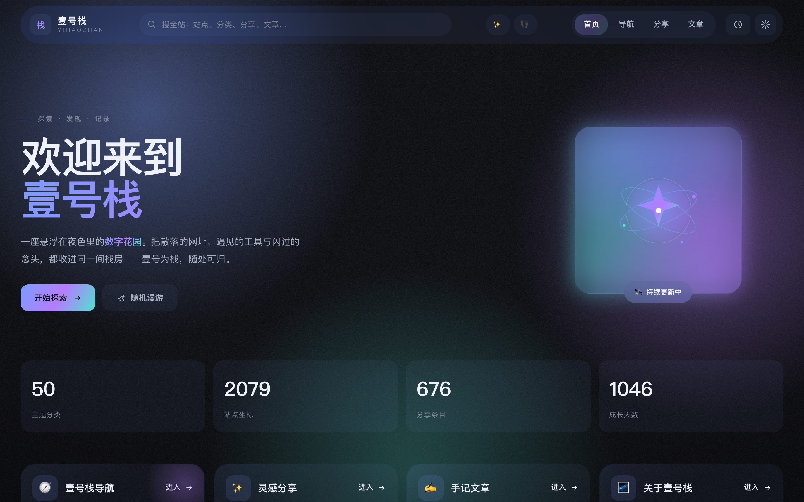 | 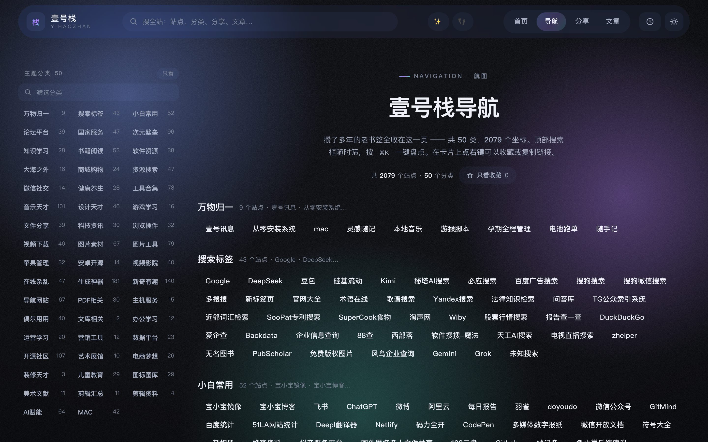 |

| 分享 · 按日期排的时间线 | 文章正文 · 目录 + 衬线排版 |
| :---: | :---: |
| 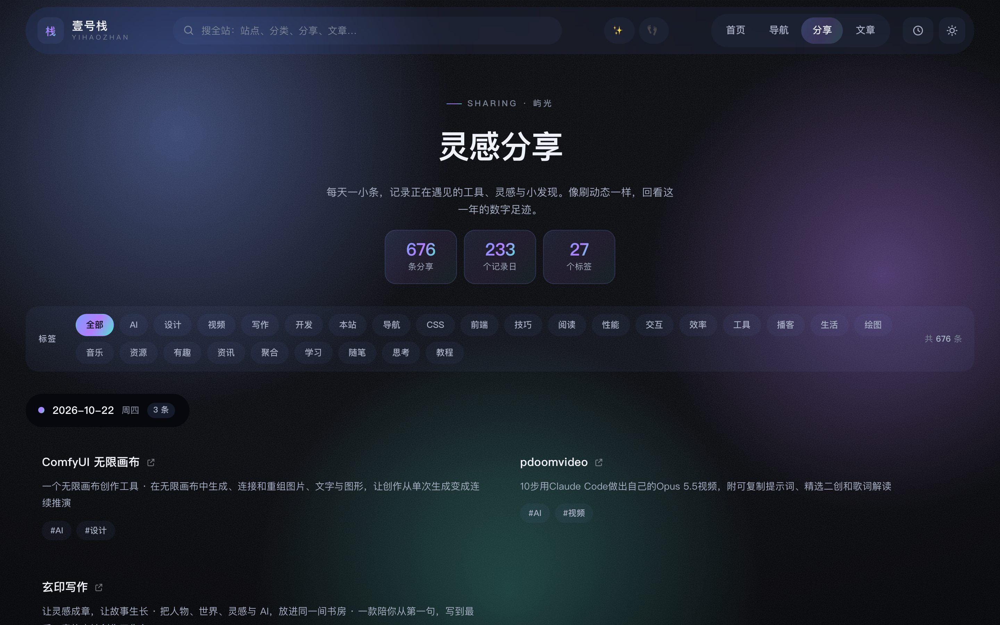 | 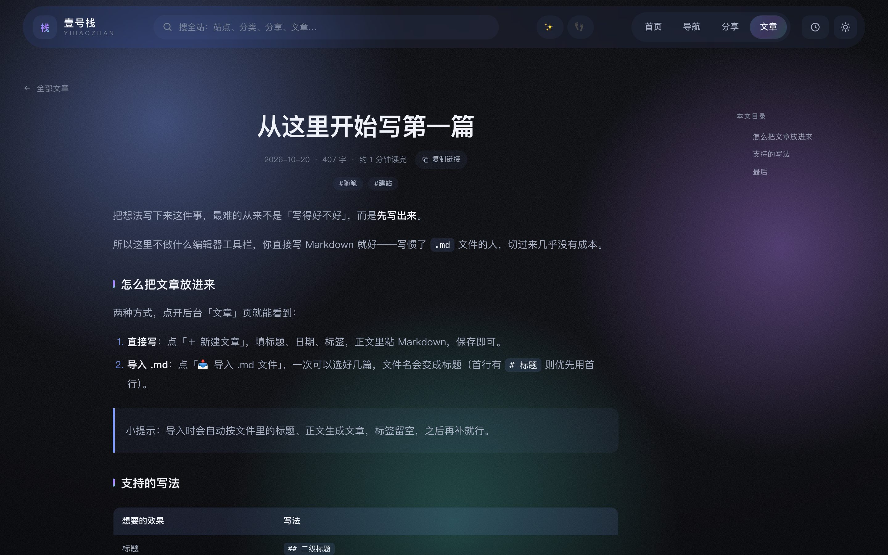 |

| 后台 · 主题与配色（换一套强调整站跟着变） |
| :---: |
| 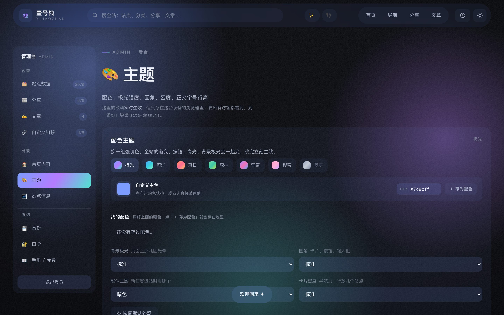 |

### 手机端 · 浏览器

| 首页 | 导航 | 文章正文 |
| :---: | :---: | :---: |
| 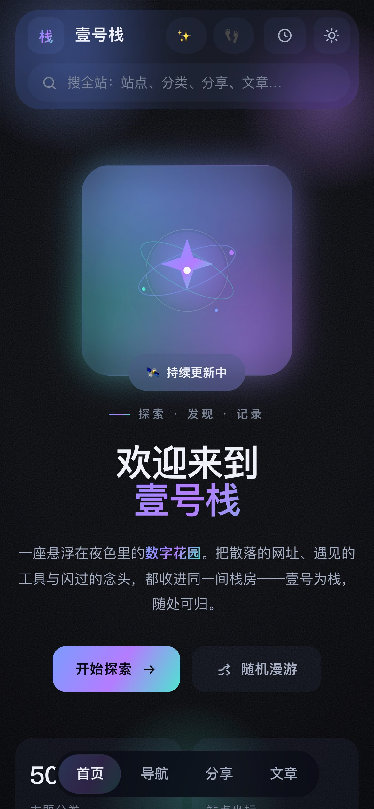 | 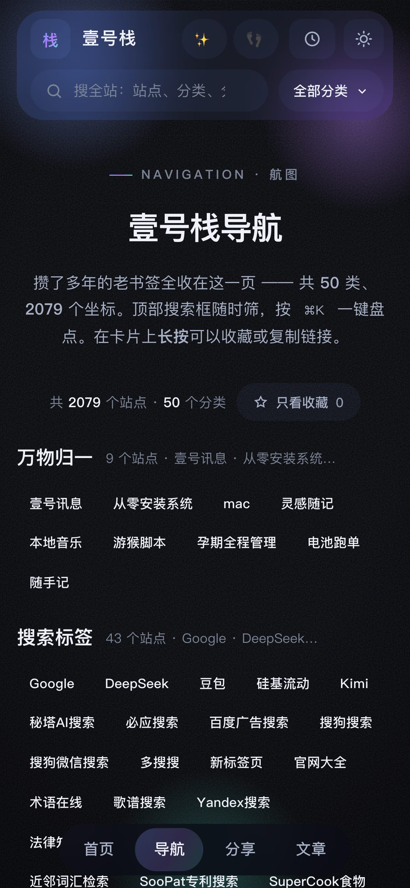 | 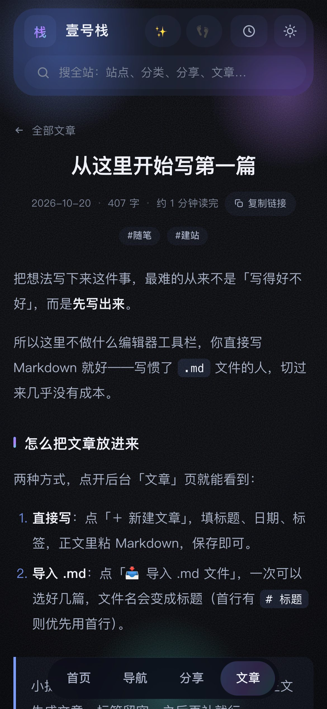 |

> 同一套页面，手机上下窄了自动改版：主导航从顶栏挪到屏幕下方居中（悬浮药丸），
> 链接卡片按名字长短自动排，不折行。

### 安卓 App · Kotlin + Compose 原生

| 首页 | 导航 | 文章 | 设置 |
| :---: | :---: | :---: | :---: |
| 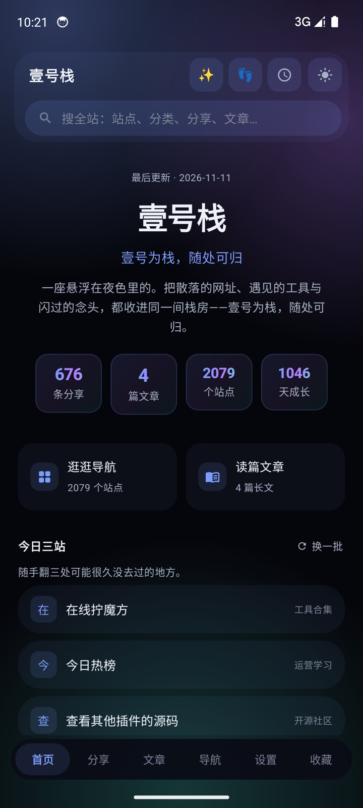 | 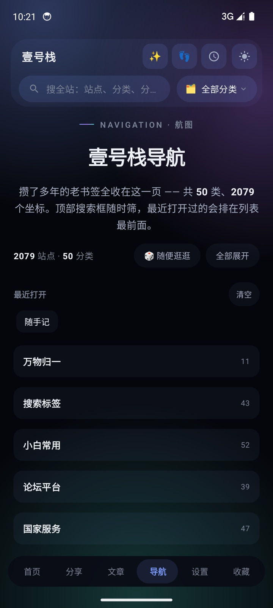 | 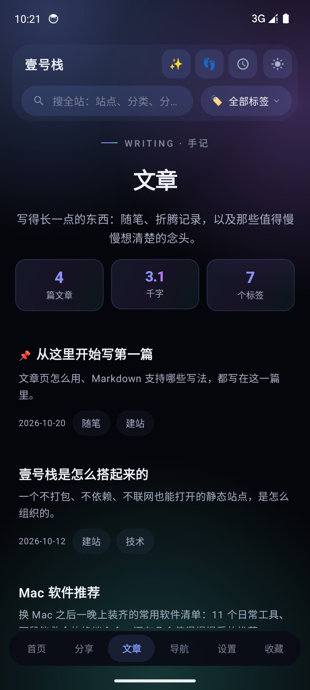 | 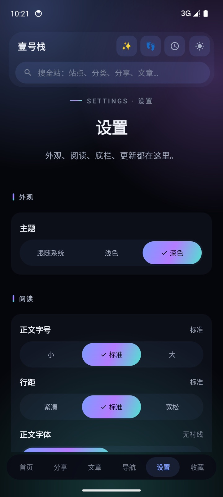 |

> App 是原生写的（不是套壳 WebView）：底栏六项（首页 / 分享 / 文章 / 导航 / 设置 / 收藏）、全站下拉刷新、阅读页朗读与语速、
> 灵感随记、本地音乐、摘录本、稍后读离线快照。内容跟网页端同源 —— 都读 `api/app.json`，
> 后台改完手机打开就是新的。APK 走站点同域，不用翻墙：[下载最新版](https://mackxin.github.io/xingyu/api/app.apk)（约 1.6 MB）。

> 所有界面都能在后台实时改：**配色、圆角、字号、行高、字体、正文宽度**都是变量，改完立刻生效，不用构建也不用刷新。

---

## 快速开始

无需构建、无依赖，两种打开方式任选：

```bash
# 方式一：直接双击 index.html（file:// 即可运行）

# 方式二：本地起服务（推荐，localStorage 收藏功能可正常持久化）
python3 -m http.server 8321
# 然后访问 http://127.0.0.1:8321
```

### 版本管理

仓库已经用 git 管着（`.gitignore` 忽略了 macOS 在 exFAT 盘上生成的 `._*` 副产物）。
改代码前先存一次锚点，改坏了随时能回：

```bash
git add -A && git commit -m "这次改了什么"
git diff          # 看自己改了什么
git checkout -- . # 放弃还没提交的改动
```

## 目录结构

```
├── index.html              # 应用外壳（顶栏含全局搜索 + 自定义链接 / 手机端底部 tab 栏 / 页脚 / ⌘K 命令面板 / 快捷键面板）
├── manifest.webmanifest    # PWA 清单：装到手机主屏时的名称、图标、启动页
├── sw.js                   # Service Worker：离线缓存（版本号要和 index.html 的 ?v= 一起改）
├── content/site.json       # ★ 全站内容就这一个文件（导航 / 分享 / 文章 / 外观）
├── tools/build-content.js  # ★ content/site.json → assets/js/site-data.js（先校验再写，写错就停）
├── feed.xml                # RSS 订阅源（由 tools/gen-feed.js 生成，别手改）
├── tools/gen-feed.js       # 改完「分享」或「文章」后跑一下，重新生成 feed.xml
├── tools/import-naver.py   # 把「壹号导航」naver.html 里的书签抽成 bookmarks.js（见下文「搬老书签进来」）
├── tools/check-links.py    # 并发探测全部链接死活（直连 + 代理复验），输出死链清单
├── tools/dead-links.txt    # 死链清单（check-links.py 生成，import-naver.py 生成时会跳过）
├── docs/screenshots/       # README 里的界面预览图（网页端用 tools/shot-readme.js 重拍，App 端用 adb screencap）
└── assets
    ├── og-cover.png        # 分享卡片封面（1200×630，微信/微博/iMessage 抓这张）
    ├── icon-180.png        # iOS 添加到主屏的图标（180×180）
    ├── icon-192.png        # PWA 图标
    ├── icon-512.png        # PWA 图标（同时用作 maskable）
    ├── css/style.css       # 全部样式：设计变量、玻璃组件、后台、响应式
    └── js
        ├── config.js       # ★ 配置层：站名/标语/建站日期/主题配色/阅读排版/导航页显示开关/卡片密度/首页文案与图片/Logo/自定义链接/文章读写
        ├── bookmarks.js    # 导航数据：50 个分类 / 2078 条链接（自动生成，别手改）
        ├── data.js         # 兜底层：site-data.js 为空时才用它（出厂状态，平时不生效，别改）
        ├── site-data.js    # ☆ 产物：由 content/site.json 烘出来，别手改
        ├── md.js           # 手写的零依赖 Markdown 渲染器（文章正文用）
        ├── app.js          # 逻辑：hash 路由、渲染、搜索、收藏、主题、滑动
        └── admin.js        # 后台管理面板（#/admin）
```

## 后台管理（`#/admin`）

页脚点 **⚙︎ 后台管理**，或直接访问 `#/admin`。默认口令 **`xingyu`**，进去后可在「口令」页修改。
纯前端实现（无服务器）：后台改的东西都存在浏览器 `localStorage`（只有你自己看得到）——
外观类实时生效；**内容（导航 / 分享 / 文章）存成草稿**，要走「发布上线 → 导出 site.json → 拖到桌面脚本」
才进仓库、才上线。

> **后台这把锁是「别让人误入」，不是安全边界 —— 你自己知道就够了。**
>
> 三点说明白：
>
> 1. 口令校验全在前端，默认口令就明写在公开仓库的 `config.js` 里；自定义口令也只是
>    存在你自己浏览器的 `localStorage` 里（32 位校验值，真要反推几秒钟的事）。
> 2. 但**后台改不动线上**：它写的是操作者自己浏览器的 `localStorage`，线上内容只能由你
>    （FTP / 仓库权限）替换。所以别人闯进后台，看到的是他自己本机那份数据 —— 而这本来
>    就是公开的站点内容，没有任何私密信息。
> 3. 真正要守住的是另外两把钥匙：**GitHub 账号**（能 push 就能改 Pages 上的一切）和
>    **`~/.xy-ftp`**（FTP 密码，能改国内镜像）。这两样都在你自己机器上，别外借、别进仓库。
>
> 想让它看起来更像把锁，就在「口令」页设一个自己的口令 —— 但那只在你这台机器上生效，
> 线上访客用的一直是 `config.js` 里的默认值。别指望它挡住有心人。

后台是**左右布局**——左侧常驻导航（带数据角标）+ 右侧内容区，整体全宽铺满；
窄屏（≤960px）时左侧导航自动变成顶部横向标签条。

| 标签页 | 能做什么 |
| --- | --- |
| **首页内容** | 编辑首页的一切：首屏**文字**（小标签 / 两行主标题 / 描述前后半句 / **轮换词**）、**首屏图片**（上传自己的照片或填图片网址，可设铺满或完整显示）、两个**按钮**文字与链接、图片上的小徽章、**数字统计**（自动统计分类数/站点数/分享数/成长天数，或自己填数字，可拖动排序）、**快捷入口卡片**（增删改、图标、拖动排序、星光）、**今日精选**（标题 / 副标题 / 显示条数，还能**勾选显示哪几条**：勾上的才出现，一条不勾就自动取最新几条）、**关于这一页**（标题 / 导语 / 更新日期 / Markdown 正文，点进去就是 `#/about`）、**赞助**（开关 + 标题 + 说明 + 备注 + **多张收款码**，每张能单独配名字和跳转 + 「去支持」链接）。每项都能单独恢复默认 |
| **主题** | **配色 / 阅读**自定义（详见下面「主题与阅读」）：7 套预设配色 + 任意自定义主色 + **「我的配色」存多套随时切回**、背景极光强度、圆角大小、默认主题、卡片密度；还有文章页的**字号 / 行高 / 字体 / 正文宽度 / 右侧目录**。旁边就是**实时预览**，改一下马上能看到效果 |
| 自定义链接 | 添加自己想放的链接，**最多 5 个**（图标 + 名称 + 链接），**可拖动排序**、可删除，显示在顶栏搜索框右侧，全站常驻。**图标是可选的**：填一个 emoji（如 🐙 📚 🎧）即可，后台点 🙂 可直接挑；**留空则只显示文字名称** |
| 站点信息 | 改站名、拉丁名、标语、**建站日期**（首页「成长天数」从这天开始数，日历里直接选）、**顶栏 Logo 图片**、**浏览器标签图标 Favicon**；还有**「顶栏显示」六道开关 —— 品牌 / 自定义入口 / 搜索条 / 筛选胶囊（分类·标签）/ 稍后读 / 白天黑夜**，关哪样顶栏就少哪块（App 跟网页端读同一组开关，两边一起变，全关就整条顶栏收掉）；以及导航页的**三个显示开关 —— 卡片图标 / 卡片介绍（域名）/ 分类图标**，三项**默认全关**，导航页只剩名字，一行能看更多站点 |
| 备份 | 最上面是**「发布上线」**：后台改 → **⬇ 导出 site.json（全站内容）** → 想先看效果就拖到「壹号栈 · 本地预览」（只在本机，不推远端）→ 满意了拖到「壹号栈 · 拖文件上传」。全站内容就这一个文件；校验不过会点出行列并停下，不会把坏数据发出去。折叠区里还有「核对线上」「下载 feed.xml」「🧹 清掉本机旧副本」。下面接着**版本历史**（改动前自动留底 + 📌 手动命名快照，误删能回退）、**下载备份文件**、**从备份恢复**、**云备份到 GitHub Gist**、几个**恢复默认**（都会先弹确认框） |
| 口令 | 修改访问口令 |
| **手册 / 参数** | 后台自带的一份**使用手册**（前台四个页面各管什么、全部快捷键、怎么切页、手机上怎么操作、`后台每个面板` 干什么、五个最常见操作的步骤、三件容易白折腾的事）和一份**技术参数**（零依赖 SPA 的架构与路由、渲染方式、Service Worker 离线、数据文件分工、`localStorage` 每个 key 存什么、部署在哪）；里面的数字是**实时读出来的**：缓存版本、分类 / 站点数、分享条目、文章数、本机存储占用、首屏 DOM 就绪耗时。两块各带一个「复制」按钮，粘到聊天里就能发给别人 |

### 换图片

后台能换四处图片，都是**「📁 上传图片」或「填图片网址」二选一**，想反悔点「↺ 用回默认」：

| 位置 | 在哪改 | 建议尺寸 |
| --- | --- | --- |
| **首页右侧大图** | 「首页内容」→ 首屏图片 | 形状可选**正方形 / 长方形 / 跟随原图比例**；还能设**点击跳转**；会自动压到 1100px 以内 |
| **赞助图 / 收款码** | 「首页内容」→ 赞助 | 可以放**多张**（支付宝 / 微信 / 云闪付…），正方形最好看；一张不放就显示一个 ☕ |
| **顶栏 Logo** | 「站点信息」→ 顶栏 Logo | 正方形 PNG，建议透明或深色背景 |
| **浏览器标签图标** | 「站点信息」→ Favicon | 64×64 方形 PNG / SVG / ICO |

> 上传的图片会被**自动压缩**（长边缩到 1100px、转成 JPEG）后再存进浏览器，
> 所以不用担心手机拍的大图拖慢打开速度。图片是存在本机的，想换电脑就把它一起放进备份文件里（备份会自动包含图片）。

> 站点数据全部来自 `assets/js/bookmarks.js`（50 个分类 / 2078 个站点，由 `tools/import-naver.py` 生成），
> `data.js` 只负责把它接起来；在后台改过之后就会以你的版本为准（存在本机），
> 点「恢复默认数据」即可还原成 `bookmarks.js` 里的内容（会先弹确认框）。
>
> **备份页怎么用**：点「⬇ 下载备份文件」得到一个 `xingyu-backup-日期.json`；
> 换电脑或想还原时点「📂 选择备份文件」选中它，确认一下就恢复了。
> 所有破坏性操作（恢复备份 / 恢复默认设置 / 恢复默认数据）都会先弹确认框。

### 改内容（v169 起：后台改 → 导出 site.json → 拖一下）

全站内容只有**一个文件**：`content/site.json`。导航、分享、文章、外观全在里面。

| 键 | 管什么 |
| --- | --- |
| `site` | 站名、标语、配色、首页文案、今日精选、关于页、赞助位 |
| `nav` | 导航分类与站点（50 分类 / 2081 条链接） |
| `feed` | 「分享」页时间线，一条一个对象 |
| `posts` | 文章，一篇一个对象，`body` 是 Markdown 正文 |
| `entries` | 首页那几张快捷卡片 |

**平时就这么干**（不用记命令）：

1. 页脚 **⚙︎ 后台管理** → 左边「导航 / 分享 / 文章 / 首页内容 / 主题 / 站点信息」改
2. 点「💾 发布上线 → **⬇ 导出 site.json（全站内容）**」
3. **（可选）想先看效果**：拖到桌面「壹号栈 · 本地预览」，或双击它
4. 满意了，拖到桌面「壹号栈 · 拖文件上传」

第 3 步只做三件事：校验 → 烘产物 → 本机开个页面。**不提交、不推送、不传镜像**，看完不满意接着改，远端一点没动。

第 4 步它自己走完：拷进 `content/site.json` → 校验 → 构建 → 推 GitHub → 传镜像 → 逐项核对。
网页 / App / 仓库 / 国内镜像，四处一起新。

> **覆盖 `content/site.json` 本身不会让网站变。** 站点运行时只读烘出来的
> `assets/js/site-data.js`，从来不读源文件。漏了「烘」这一步，前台就一直显示旧的 ——
> 这也正是「我覆盖了文件怎么还看不到」的唯一常见原因。双击「本地预览」就是补这一步。

**想改完立刻看到、连导出都省掉**：双击「壹号栈 · 本地预览」，在它打开的地址
（`127.0.0.1`）上进后台改。预览环境里前台**直接读草稿**，切到前台就是最新的；
左下角会挂一条「草稿预览」提醒你「这还不是线上」，点它「去发布」直接落到发布面板。
线上域名下前台永远只读 `site-data.js`，不会出现「本机一套、线上一套」。

| # | 做什么 | 哪一端变新 |
| --- | --- | --- |
| 1 | 校验 `content/site.json` → 构建 `assets/js/site-data.js` | 写错会**报第几行第几列并停下**，这次不发布 |
| 2 | 重烘 `api/app.json` + `feed.xml` + `app.json.gz` | App 的数据源、RSS 订阅 |
| 3 | git 提交并推送 | 仓库、GitHub Pages 网页 |
| 4 | 增量传国内虚拟主机 | `http://yihaozhan.xyz/` |
| 5 | 清 jsDelivr 缓存 | App 的兜底源 |
| 6 | 核对镜像 / Pages 的版本号 | 直接告诉你同步上没有 |

```bash
python3 tools/preview.py         # 本地预览：烘一次 + 本机开页面，不碰远端
python3 tools/sync.py            # 常规：校验 + 构建 + 推到全端
python3 tools/sync.py --all      # 这次改了代码：整站重传镜像（默认只传变了的文件）
python3 tools/sync.py --no-ftp   # 只推 GitHub，不动镜像
python3 tools/sync.py --dry      # 只说要做什么，什么都不动
node tools/build-content.js      # 只构建；加 --check 只校验不写
python3 tools/upload-files.py 文件   # 补传单个文件（镜像掉了东西时）
```

**三个产物别手改** —— 都是现烘的，下次构建就覆盖：

| 产物 | 谁读 |
| --- | --- |
| `assets/js/site-data.js` | 网页（`index.html` 把它放在所有脚本最前面） |
| `api/app.json` / `.gz` | App（配了镜像就只问镜像） |
| `feed.xml` | RSS 订阅源 |

**在手机 / 别的电脑上发一条**：GitHub 网页打开 `content/site.json`，改 `feed` 里那几条、提交，
`.github/workflows/rebake.yml` 会自动跑构建并提交产物（几分钟后网页和 App 都新）。

> **后台改的是草稿，不是线上。** 这是故意的 —— v167 之前内容有三份来源
> （本机 `localStorage` / 导出的快照 / 仓库源码），才出现「本机一套、手机另一套」。
> 现在前台永远读 `site-data.js`（来自 `content/site.json`），后台草稿存在
> `xingyu.draft.v1` 里、只有后台自己读，导出时自动清空。
> 所以「后台改了网站没变」不是 bug —— 是还没走上面第 2、3 步。

## 主题与阅读（自定义外观）

`#/admin` →「**主题**」。上半张卡管**颜色**，下半张卡管**读起来累不累**，改完立刻生效、不用刷新，旁边就是实时预览。

### 配色

| 能改什么 | 选项 |
| --- | --- |
| **配色** | 7 套预设：极光（默认）/ 海洋 / 落日 / 森林 / 葡萄 / 樱粉 / 墨灰；也可以**自己挑一个主色**，或者直接在 `HEX` 框里**敲色值**（如 `#ff1d55`） |
| **我的配色** | 自己挑的颜色可以**存成一套**（配色 A / B / C…，最多 8 套），以后一键切回；支持改名、删除 |
| **背景极光** | 强 · 气氛更足 / 标准 / 关掉 · 更干净 |
| **圆角** | 小 · 干练 / 标准 / 大 · 圆润 |
| **默认主题** | 暗色 / 明亮（新访客进站时用哪个；右上角月亮按钮仍可随时切） |
| **卡片密度** | 紧凑 / 标准 / 宽松（卡片的字号与内距；宽度由站名长短决定，不再固定列宽） |

- 自定义主色只要给**一个**颜色，另外两个渐变色会按色相自动推（+36° / −56°），所以随便挑也不会出现「脏渐变」
- **手敲色值**：`#ff1d55`、`ff1d55`、`#f15`（三位简写自动补成 `#ff1155`）都认，粘贴进来也行，非十六进制字符会被自动挡掉。敲满 6 位立刻生效（不用等回车），按回车会提示一句「主色已换成 …」；4~5 位算半截，框会变红提示，回车不改色、切走自动还原成当前色。点色块用的系统调色盘和这个输入框是双向同步的
- 配色一变，**按钮、链接、徽标、滚动进度条、选中文字、背景极光、焦点光环**会一起换掉，不是只换个点缀
- 改乱了点「↺ 恢复默认外观」，一键回到极光 + 标准光晕 + 标准圆角。**「我的配色」不会被清掉**——那是你的存货，不是当前外观

#### 我的配色（存多套随时切回）

调好一个自定义主色后，点右边的「**＋ 存为配色**」，它就会出现在下面那一排：

| 操作 | 怎么做 |
| --- | --- |
| 切回某一套 | 点它一下（色点 + 名字），全站立刻换过去 |
| 改名 | 点 ✎，直接改，**回车**保存 / **Esc** 放弃 |
| 删除 | 点 ×，确认一下。删的只是这套存货，**当前页面的颜色不会变** |
| 存不下 | 最多 8 套，存满后按钮会变灰，先删一套再存 |
| 同一个颜色 | 已经存过的颜色会被挡下来并提示是哪一套，不会出现两个一样的 |

切到内置色板（比如「落日」）时，「自定义主色」会跟着同步成那个色板的主色——所以你紧接着点「存为配色」，存下的就是你**眼下看到的颜色**，不会是上一次的旧色。

### 阅读

只影响文章正文（`#/post/<id>`），让长文读起来更舒服：

| 项 | 选项 | 默认 |
| --- | --- | --- |
| 正文字号 | 14 – 20 px 滑杆 | 16 px |
| 行高 | 紧凑 1.6 / 标准 1.75 / 舒展 1.95 / 宽松 2.1 | 1.95 |
| 字体 | 系统无衬线（清晰）/ 衬线（更像纸书） | 无衬线 |
| 正文宽度 | 窄 680 / 偏窄 760 / 标准 820 / 偏宽 900 / 宽 980 | 820 |
| 右侧目录 | 开 / 关（标题 ≥3 个且宽屏时才出现；关掉后正文自动居中占满） | 开 |

> 手机上字号会自动小半号，长行也会自动收窄，不用担心调大了在手机上一行只放几个字。

### 存在哪

- 存在 `xingyu.config.v1` 的 `theme` / `read` 两段，和别的后台设置一样**只在你本机**
- **下载备份 / Gist 云备份都会带上**（设置整包一起走），换设备恢复就还原，「我的配色」也在里面
- 想让**所有访客**都看到同样的配色与排版：把设置写进 `index.html` 里 `config.js` 之前的 `window.XY_CONFIG`，例如
  ```js
  window.XY_CONFIG = {
    theme: { accent: 'sunset', glow: 'normal', radius: 'large' },
    read:  { size: 17, line: 1.9, font: 'serif', width: 760, toc: true }
  };
  ```
  「我的配色」也能这样预置给别人（每套就是名字 + 一个主色）：
  ```js
  theme: {
    accent: 'custom', accentColor: '#33d6a0',
    presets: [
      { name: '海盐青', color: '#33d6a0' },
      { name: '暖橘',   color: '#ff8a5c' }
    ]
  }
  ```

## 发一条分享（`#/share`）

「分享」页那条时间线也在后台管：`#/admin` →「**分享**」（左侧第二个标签）。

- 点 **＋ 新增分享** 就能加一条，字段：**日期 / 图标 / 标题 / 链接 / 描述 / 标签**
- 编辑器右侧就是**前台卡片的样子**，边打字边变，不用保存才能看效果
- 链接可以填站外网址，也可以填站内页面（`#/nav`、`#/post`、`#/post/文章id`、`#/idea`）——站内的不会新开窗口，也不显示 ↗
- **标签**用逗号分隔，会变成分享页顶部的筛选胶囊（右侧还会显示每个标签有几条）
- 列表按**日期倒序**排，同一天的几条在前台会**并排成 2～3 列**；删除要**点两下**确认
- 存在 `localStorage` 的 `xingyu.feed.v1`，**下载备份 / Gist 云备份都会带上**（备份格式 `version: 5`，v123 起多了 `ideas` 一项），备份页还有独立的「恢复默认分享」
- 想让**所有访客**都看到，把内容写进 `assets/js/data.js` 的 `feed`（`feed.xml` 也是从那里生成的，改完跑一次 `node tools/gen-feed.js`）
- **从壹号讯息导入的那批**（716 条，2026-01-01 ~ 2026-11-24）单独放在 `assets/js/feed-import.js`，由 `data.js` 拼在后面；`index.html` 里删掉引入它的那行 `<script>` 就能整批去掉，自己手写的内容不受影响。这批的**图标按域名自动挑**（GitHub 🐙 / 扩展商店 🔍…，认不出来用 ✨），**标签按关键词自动归**（AI / 设计 / 开发 / 效率 / 视频 / 写作 / 阅读 / 音乐 / 教程，最多两个），都可以在后台逐条改
  - 重跑：`python3 tools/import-qiantai.py`（下载源站 → 解析 → 覆盖 feed-import.js）。**老条目的图标和标签原样带过来**，只给新出现的条目自动推断；源站删掉的条目默认保留（加 `--drop-gone` 才一起删）。先看统计用 `--dry`
    - ⚠️ 2026-11-24：源站 `qiantai.html` 已从服务器删除，这条命令的下载步骤会 404。要增量导入只能加 `--src` 指本地备份：`python3 tools/import-qiantai.py --src ../xingyu-ftp-backup/root-before/qiantai.html`

> 分享条目多（现在 730 条）也没关系：后台「分享」列表和「今日精选」的勾选列表都是**一次全铺开**（v129 起），
> 想找某一条直接搜列表上方的搜索框 —— 后台里看到的就是数据的全部，不会藏着掖着。

## 写文章（Markdown）

顶栏第 3 个入口是 **文章**（手机端在底部 tab 栏），对应 `#/post`；
点进某篇就是阅读页 `#/post/<文章id>`。文章都写在 **Markdown** 里，渲染器是手写的（`assets/js/md.js`，零依赖）。

| 页面 | 有什么 |
| --- | --- |
| `#/post` 列表 | 按**年份分组**、标签筛选（右侧实时显示条数；窄屏收进顶栏「🏷」按钮）、📌 置顶排最前、两行摘要、字数与预计阅读时长；**大屏一行排 2–3 篇**（窄屏一篇一行）；顶部数字是「篇数 / 总字数 / 标签数」 |
| `#/post/<id>` 阅读 | 正文排版（标题、代码块、表格、任务清单、引用都有针对性样式）、**标题区居中**、**右侧悬浮目录**（宽屏且标题 ≥3 个才出现，点一下平滑跳转）、上一篇 / 下一篇、一键复制链接 |

**写一篇的三种方式：**

1. `#/admin` →「**文章**」→ **＋ 新建文章** —— 标题 / 正文 / 日期 / 标签 / 摘要 / 置顶 / 草稿都在一个页面里，右边实时显示字数和阅读时长，**👁 预览** 就地看排版
2. `#/admin` →「**文章**」→ **📥 导入 .md**（可一次多选）—— 直接把本地 `.md` 文件丢进来
3. 直接改 `assets/js/data.js` 里的 `posts` 数组（对所有访客永久生效）

### 正文支持快捷输入

新建 / 编辑文章的正文框上方有一条工具条，**选中文字再点按钮 = 给这段套格式**，再点一次就取消：

| 工具条 · 选中文字点一下套格式 | 最右边的 **?** · 快捷键一览 |
| :---: | :---: |
| 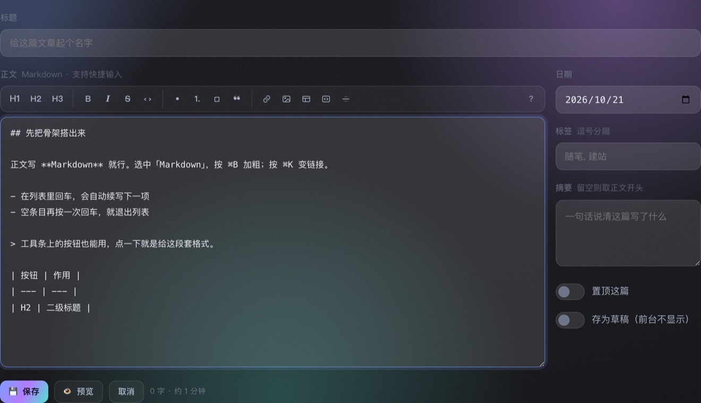 | 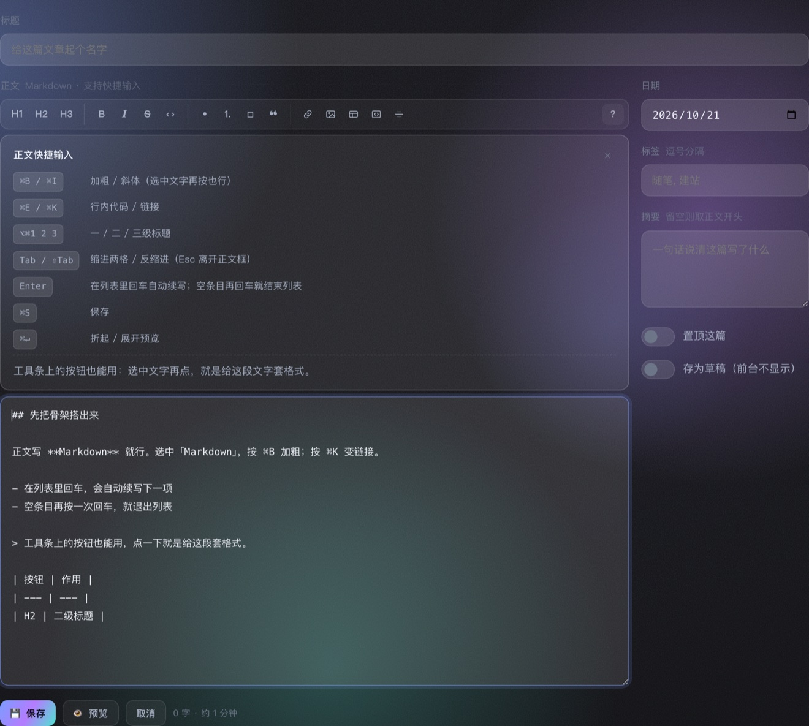 |

| 想做什么 | 工具条 | 快捷键 |
| --- | --- | --- |
| 加粗 / 斜体 / 删除线 | **B** / *I* / ~~S~~ | `⌘B` / `⌘I` / — |
| 行内代码 | `‹›` | `⌘E` |
| 一 / 二 / 三级标题 | H1 H2 H3 | `⌥⌘1` `⌥⌘2` `⌥⌘3` |
| 无序 / 有序 / 待办清单 | • / 1. / ☐ | — |
| 引用 | ❝ | — |
| 链接 / 图片 | 链接、图片两个小图标 | `⌘K` / — |
| 表格 / 代码块 / 分割线 | 最后三个小图标 | — |
| 缩进 / 反缩进两格 | — | `Tab` / `⇧Tab` |
| 保存 / 预览 | 💾 / 👁 | `⌘S` / `⌘↵` |

- **在列表里回车会自动续写下一项**（`1.` 还会自动 +1）；空条目再按回车就退出列表
- 什么都没选中时点加粗，会先塞一段占位文字并选中它，直接打字就替换掉
- 插入走的是浏览器原生编辑，所以 `⌘Z` 能一路撤销回去
- 工具条最右边的 **?** 随时能看这张表，点别处收起
- 在 macOS 上是 `⌘`，Windows / Linux 自动显示成 `Ctrl+`

**导入 .md 时的规则（按这个优先级自动取值）：**

| 字段 | 优先级 |
| --- | --- |
| 标题 | front-matter 的 `title` → 正文第一个 `# 标题` → 文件名 |
| 日期 | front-matter 的 `date` → 文件名开头的 `2026-09-01` → 文件的修改时间 |
| 标签 | front-matter 的 `tags`（逗号 / 顿号 / `#` 都认），最多 8 个 |
| 摘要 | front-matter 的 `excerpt`，没写就自动从正文里截前 160 字（会先去掉表格、代码块这些） |

文件开头可以放一段 front-matter，也可以完全不放：

```markdown
---
title: 文件名里的标题会被这个覆盖
date: 2026-10-20
tags: [随笔, 折腾, 设计]
excerpt: 列表里显示的那句摘要，不写就自动截。
---

正文从这里开始……
```

文件名也能带日期，两个都会认：`2026-09-01-我的文章.md` → 标题「我的文章」+ 日期 `2026-09-01`。

**支持的语法**（写文章够用，超出的不解析、原样显示）：

`#` ~ `######` 标题（页面内自动降一级，给文章大标题留位置）、**粗体**、*斜体*、~~删除线~~、
`行内代码`、``` 代码块（带语言标记会在左上角显示语言名）、[链接](url)、、
有序 / 无序列表（支持缩进嵌套、`- [ ]` 任务清单）、`>` 引用、`---` 分隔线、`| 表格 |`（支持 `:---:` 对齐）、裸网址自动变链接。

> 安全：渲染是**先转义 HTML 再拼标签**的，`javascript:` / `data:` 这类链接一律拦掉，
> 粘进来别人的 Markdown 也不会带进脚本。

**存在哪、怎么备份：**

- 文章存 `localStorage` 的 `xingyu.posts.v1`，和其他后台改动一样**只在你本机**；想让访客都看到，就写进 `data.js` 的 `posts`
- **下载备份文件 / GitHub Gist 云备份都已包含文章**（备份格式升到 `version: 3`），换设备能整包搬过去
- 备份页还有一个独立的 **「恢复默认文章」**，只清文章、不动站点数据
- `feed.xml` 也会带上最新文章（标题前有 📝），改完文章跑一次 `node tools/gen-feed.js`
- 标了**草稿**的文章：后台列表里带「草稿」角标，前台列表、搜索、命令面板、RSS 里都不会出现
- `data.js` 里自带**两篇示例**（「从这里开始写第一篇」和「壹号栈是怎么搭起来的」），看完可以直接删

## 把浏览器书签搬进来

不用一条条手填。先在浏览器里导出书签：

| 浏览器 | 怎么导出 |
| --- | --- |
| Chrome / Edge | 书签管理器（⌥⌘B）→ 右上角 ⋮ → **导出书签** → 存成 `.html` |
| Firefox | 书签管理（⇧⌘O）→ 导入和备份 → **导出书签到 HTML** |
| Safari | 文件 → 导出 → **书签** |

然后回到 `#/admin` →「站点数据」→ **📥 导入书签** → 选中那个 HTML 文件。

- 每个**文件夹**会变成一个**分类**；直接放在书签栏根上的会进「未分类」
- **同名分类会自动合并**，不会覆盖你已有的站点
- 已经在导航里的站点（按网址比对，忽略结尾的 `/`）会**自动跳过**，不会重复
- `javascript:` 之类的小书签会被忽略
- 导入前会先弹一个确认框告诉你：**几个分类、几个站点、跳过几个**

> 导入的内容和其他后台改动一样只存在本机。想让访客也看到，用「备份」页的「复制站点数据」写回 `data.js`。

### 从另一个导航站整站搬（naver.html）

> ⚠️ 2026-11-24：「壹号导航」`naver.html` 已从服务器删除（旧站退场），下面这条 `curl` 现在会 404。
> 抽出来的 50 个分类 / 2078 条书签早已写进 `assets/js/bookmarks.js`，站点不受影响；
> 真要重跑得用本地备份：`python3 tools/import-naver.py ../xingyu-ftp-backup/root-before/naver.html`。
> 换个导航站搬的话，换掉 URL 就行，脚本本身没变。

「壹号导航」那种整页都是链接的站，可以直接抽取，不用手抄：

```bash
# 1. 抓下那一页（它不在本地也没关系）
curl -o /tmp/naver.html http://yihaozhan.xyz/naver.html

# 2. 抽成 assets/js/bookmarks.js
python3 tools/import-naver.py /tmp/naver.html
```

脚本认的是 `<section id="section-N">` 里的 `.category-title` 与 `.category-link`，规则如下：

| 情况 | 怎么处理 |
| --- | --- |
| 站内相对链接（`qiantai.html`、`suishouji/index.html`） | 补成 `http://yihaozhan.xyz/…` 的绝对地址 |
| 同一个分类里重复出现的网址 | 只留第一条（这一轮去掉了 33 条重复） |
| 同一个站出现在不同分类 | **保留** —— 一个站同时属于「搜索」和「常用」很正常 |
| 分类 id | 统一加 `bk-` 前缀，以后自己另加分类也不会撞车 |
| 分类描述 | 自动取该类前两个站名（如「Google · DeepSeek…」） |

生成完 `bookmarks.js` 会被 `data.js` 接在精选分类后面（没有这个文件也不会报错）。想调分类名和 emoji，改脚本顶部的 `META` 表再跑一次。

**死链检测（可选，但强烈建议搬完跑一次）**：老书签里有不少站早就关了。用 `tools/check-links.py` 过一遍：

```bash
# 先直连探测，失败的自动走本地代理复验（区分「真死」和「被墙」）
python3 tools/check-links.py --proxy http://127.0.0.1:7897
```

结果写进 `tools/dead-links.txt`，再跑一次 `import-naver.py` 就会自动跳过这些网址。
判定偏保守：只有 **404 / 410 / 域名解析不了 / 连接被拒** 才算死；403、429、5xx、超时一律保留。

> 50 个分类一次全铺出来是两万多个节点。导航页**不做折叠**——进去就是把所有站点全列出来，
> 靠 CSS 的 `content-visibility:auto` 让视口外的分类块跳过布局与绘制（相当于浏览器自带的
> 虚拟滚动），配合 `contain-intrinsic-size:auto` 记住每块真实高度、滚动条长度不跳。
> 实测 4 倍 CPU 降速下滚动 p95 帧间隔 26ms，不会因为"全都摊开"而发涩。

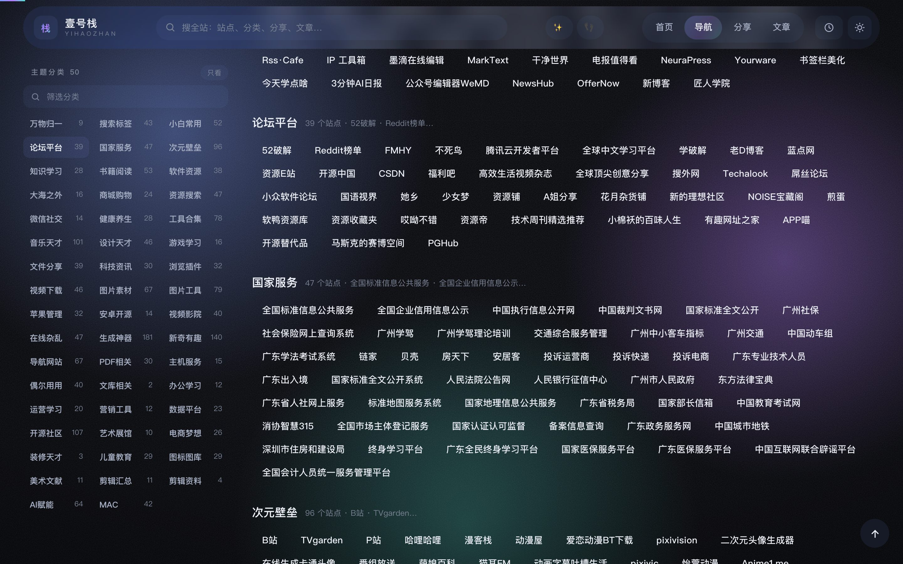

## 多设备同步（GitHub Gist）

后台 →「备份」→「云备份 · GitHub Gist」。把站点数据、设置、**收藏**和**最近访问**存进你 GitHub 账号下一个**私有 Gist**，换电脑或换浏览器时点「从云端恢复」就全回来了。

1. 打开 <https://github.com/settings/tokens> → Generate new token (**classic**) → 只勾 **`gist`** → 生成
2. 把 Token 粘进后台那个框 → 点 **⬆ 上传到云端**（第一次会自动新建私有 Gist）
3. 之后每次改动再点一次上传即可；换设备时填同一个 Token 就能「从云端恢复」

> Token 只存在你这台浏览器的 `localStorage`，只发往 `api.github.com`。
> 公用电脑上用完点「断开」。Gist 里是明文 JSON，介意的话就别放敏感内容。

## 装到手机主屏（PWA）

这是个 PWA —— 打开线上地址后：

- **iPhone**：Safari → 分享 → **添加到主屏幕**
- **Android**：Chrome → 右上角 ⋮ → **添加到主屏幕 / 安装应用**

装完就是个独立图标，打开没有浏览器地址栏，**断网也能看已经访问过的内容**（`sw.js` 缓存了页面和资源）。

> 改版后想让老用户立刻拿到新版：把 `sw.js` 里的 `VERSION` 和 `index.html` 里所有 `?v=` 一起 +1。
> 页面本身是「网络优先」，所以刷新就能看到新内容，不会卡在旧版。

## 安卓 App

网页装进浏览器是 PWA，装到手机上还有一份**原生 App**（Kotlin + Compose，不是套壳 WebView）。

- **下载**：[`api/app.apk`](https://mackxin.github.io/xingyu/api/app.apk)（约 1.6 MB；站点同域，不用翻墙也不用 GitHub 直链）。
- **内容同源**：App 读的就是本站 `api/app.json`（由 `tools/gen-app-json.js` 从后台数据烘出来）。
  站上改了导航、文章、分享、帮助、更新日志，手机打开就是新的，**不用发新版 App**。
- **装了之后能干什么**：底栏六项（首页 / 分享 / 文章 / 导航 / 设置 / 收藏）、全站下拉刷新、
  阅读页朗读 + 语速 + 定时停止、正文里的链接点一下就开（长按仍是整段存摘录）、
  稍后读存正文快照（离线可看）、灵感随记（原生编辑 + 回收站）、
  本地音乐（扫描本机 + 歌词 + 睡眠定时）、摘录本、站点巡检、足迹热力图、桌面小组件。
- **自己更新自己**：设置 →「版本更新」能检查并下载新版，支持断点续传；
  数据源可在 GitHub / 自建镜像之间切换（镜像还带 `app.json.gz` 压缩，国内快不少）。
- **源码**：[`Mackxin/yihaozhan-app`](https://github.com/Mackxin/yihaozhan-app)，
  发版记录见 [Releases](https://github.com/Mackxin/yihaozhan-app/releases) 与站内 `#/changelog`。

## 订阅（RSS）

`feed.xml` 是「分享 + 文章」的订阅源，页脚有 **📡 RSS** 入口，任何阅读器（Feedly / Inoreader / Reeder…）都能订阅。

```bash
# 改了 data.js 里的 feed / posts 之后，重新生成一次
node tools/gen-feed.js
# 换域名了就带上新地址
node tools/gen-feed.js https://your-domain.com/
```

> 静态站点没有后端，订阅源是**构建产物**：改完分享条目要记得重新跑一次脚本，否则订阅里看不到新内容。
> 已自动处理：按日期倒序、取最新 20 条、站内 `#/nav` 这类相对链接补成完整网址。

## 分享卡片与 SEO

`index.html` 的 `<head>` 里已经备好一整套分享卡片标签（Open Graph + Twitter Card）：

> ✅ **线上地址：<https://mackxin.github.io/xingyu/>**（GitHub Pages，推 `main` 即自动发布）

| 文件 | 用在哪 |
| --- | --- |
| `assets/og-cover.png` | 1200×630 的分享封面，微信 / 微博 / iMessage / Slack 转发时显示的图 |
| `assets/icon-180.png` | iOS「添加到主屏幕」的图标 |

> ⚠️ **换域名必做**：`og:image` / `twitter:image` / `apple-touch-icon` 写的是**完整网址**
> （大多数平台只吃绝对路径），现在是 `https://mackxin.github.io/xingyu/...`。
> 换成自己的域名后，把 `index.html` 里这几处前缀一并替换，分享卡片才会出图。
>
> 想换封面：直接替换 `assets/og-cover.png` 这张图（保持 1200×630）即可。

## 部署到自己的域名

纯静态站点，任何静态托管都能放（不需要 Node、不需要构建）。

**当前状态：同时挂在两个地方** —— GitHub Pages（`mackxin.github.io/xingyu/`）
和香港虚拟主机 `http://yihaozhan.xyz/`，App 优先读镜像。

所以日常更新**不要**只 `git push` —— 那样镜像和 App 还是旧的。走
[「发一次内容」](#发一次内容两步管到全部端) 那两步就行，它会一起摆平。

```bash
# 想纯手工也行（等价于同步脚本的第 3 步，其余各端不会跟着变）
git add -A && git commit -m "说明这次改了什么"
git push
```

从零再建一个同样的站（换号 / 换项目时参考）：

```bash
# 0. 前提：装好 gh（本机在 ~/.local/bin/gh）并已登录
export PATH="$HOME/.local/bin:$PATH"

# 1. 建仓库并推上去
gh repo create xingyu --public --source=. --remote=origin --push

# 2. 开 Pages：仓库 → Settings → Pages → Source 选 `main` / `root` → Save
#    或用命令行一次搞定：
gh api -X POST repos/<用户名>/xingyu/pages \
  -f "source[branch]=main" -f "source[path]=/"
```

> 用自定义域名（如 `xingyu.yourdomain.xyz`）时，在仓库根目录加一个 `CNAME` 文件，
> 内容就写域名本身；再去域名商那里加一条 `CNAME` 解析指向 `<用户名>.github.io`。
> 记得同时改掉 `index.html` 里写死的分享图网址。
>
> **注意**：因为用的是 `#/xxx` 形式的 hash 路由，服务器不需要任何 rewrite 规则，
> 刷新任意页面都不会 404 —— 这是静态托管最省心的那种。

### 换虚拟主机 / 换域名怎么对接

站点的**国内镜像**（`http://yihaozhan.xyz/`，香港 Freehost 那台 IIS）靠 FTP 推，
所有凭据和地址都放在一个文件里：`~/.xy-ftp`（权限 600，不进仓库）。

```
host=<FTP 主机>
user=<账号>
pass=<密码>
root=/wwwroot        ← 站点在这个 FTP 账号下的根目录
url=http://yihaozhan.xyz/   ← 对外访问地址，脚本拿它做核对
```

`tools/sync.py` 的 `MIRROR`、`tools/verify-ftp.py` 的默认核对地址都从这里读，
**所以换地址只改这一个文件，不用动代码**。

换好之后按这个顺序走一遍（第一次是全量）：

```bash
# 1. 先看清单，确认要传哪些、传到哪
python3 tools/deploy-ftp.py --dry

# 2. 全量传（28 个文件，限流下要半小时以上，用后台跑）
python3 tools/deploy-ftp.py

# 3. 逐个核对（走 HTTP，比 FTP 日志可靠）
python3 tools/verify-ftp.py

# 4. 剩下没传上去的，一个一个补（一条连接一个文件，别连着传）
python3 tools/deploy-ftp.py --files index.html
```

**新主机得满足这几条**，不然 App 那头会瘸：

| 要求 | 为什么 |
|---|---|
| 支持 PASV 被动模式 | `deploy-ftp.py` 用的是被动模式 |
| 能给 `.apk` 正确的 MIME | IIS 默认拒签 `.apk`，靠仓库里的 `web.config` 放行；Nginx/Apache 一般不用管 |
| `.md` / `.webmanifest` 能正常返回 | 同上是 MIME 问题，缺了就 404.3（`data/help.md` 是 App 帮助页的正文） |
| 静态文件原样返回，不要二次压缩/改名 | `api/app.json.gz` 是给 App 吃的，它认 gzip 魔数自己解 |
| 允许 HTTP（不强制跳 HTTPS）也不打紧 | 只有 HTTP 也能用，但 App 里填镜像地址**必须带 `http://`** |

另外两件事容易忘：

- **换域名**还要改 `index.html` 里 4 处写死的网址（`og:url`、`og:image`、`twitter:image`、
  `apple-touch-icon`，现在是 GitHub Pages 的地址），否则微信/微博抓分享卡片还是旧的。
- **App 里的镜像地址**是用户自己在「设置」里填的，换域名后得让他手动改；
  更新包的地址是「镜像地址 + `api/app.apk`」，会跟着自动走。

### 发版清单（照这个顺序，别漏）

**只改内容**（发分享、加站点、改配色、写文章）—— 三步，见上面那节：

```
① 后台「备份 → 发布上线」→ ⬇ 导出 site.json（全站内容就这一个文件）
② （可选）拖到桌面「壹号栈 · 本地预览」看一眼，只在本机，不推远端
③ 拖到桌面「壹号栈 · 拖文件上传」，或覆盖进 content/site.json 后双击「一键同步」
```

版本号**不用动**：`site-data.js` 不带 `?v=`，`sw.js` 给它单独开了网络优先。

**改了代码**（css / js / html）—— 多一步提版本号，其余一样：

```bash
# 1. 提版本号：index.html 里 11 处 ?v=NN 和 sw.js 的 VERSION 一起 +1
#    （不改的话，老访客的离线缓存还拿着旧文件，看不到你的改动）

# 2. 一条命令：重烘 app.json/feed.xml → 提交推送 → 整站重传镜像 → 清 CDN → 核对三端
xysync --all --msg "这次改了什么"
```

默认只传「上次同步成功之后变过的那几个文件」，基准记在 `.git/xy-mirror-base` ——
所以事先手动 `git commit` 过也不会漏。只有怀疑镜像和仓库对不上（比如某次 FTP 中途断了）
才需要 `--all` 整站重传。

### 单个文件补传：拖进去就行

整条链子跑完，`xysync` 会告诉你哪几个没传上去。补的时候别再去翻命令 ——
把文件**拖到桌面的「壹号栈 · 拖文件上传」图标上**，剩下的它自己做：

```
把文件拖到图标上   →  自动判断该放服务器哪个位置
                   →  传一个、核对一个（走 HTTP 比大小）
                   →  ✓ 已核对 / ✗ 加原因，最后给一句总结
```

**不用输账号密码** —— 存在 `~/.xy-ftp`（权限 600）里，第一次用会问一遍并保存。
**也不用想路径**，它按两条规则自己认：

| 你拖的东西 | 传到哪 |
|---|---|
| 仓库目录里的文件 | 按它相对仓库根的位置（`assets/css/style.css` → `assets/css/style.css`） |
| 下载夹里的 `site-data.js` | `assets/js/site-data.js` |
| 下载夹里的 `app.json` / `feed.xml` / `sw.js` / `app.apk` 等 | 各自的固定位置（清单见 `tools/upload-files.py` 的 `KNOWN`） |
| 认不出的文件、README、`tools/` 里的脚本 | 拒绝，并说明原因 |

不想拖也行：**双击那个图标**会弹系统选择框，可以多选。命令行等价物：

```bash
python3 tools/upload-files.py 文件 [文件…]     # 直接点名
python3 tools/upload-files.py --pick           # 弹窗选
python3 tools/upload-files.py --dry 文件        # 只看会传到哪，不真传
```

> 为什么一个文件一个文件传：这台主机会对连续的 FTP 数据连接限流（425），
> 一批传三个就可能连环失败、而且失败时服务器会**把文件删掉**。
> 所以脚本排队、每个之间歇 2 秒，传完立刻用 HTTP 核对 —— 不看 FTP 的回话。

## 页面一览

| 路由 | 页面 | 说明 |
| --- | --- | --- |
| `#/home`  | 首页 | Hero（大图可选正方形 / 长方形 / 跟随原图，可设点击跳转）+ 数字滚动统计 + Bento 入口（大屏一行最多 4 列）+ 今日精选横轨（显示哪几条在后台「首页内容 → 今日精选」里勾）+ 赞助（可放多张收款码） |
| `#/nav`   | 导航 | 50 个分类 / 2078 个站点（从「壹号导航」整站搬来，已剔除死链）、**全部默认展开**（视口外的分类靠 `content-visibility` 按需渲染）、分类侧栏（**可筛选 / 手机端可展开 / 可勾选只看某几个分类**）与滚动联动、收藏；标题区**整块居中**（小标签 / 大标题 / 说明 / 统计与「只看收藏」都落在同一条中轴线上）；**卡片宽度跟着站名长度自适应**（`flex-wrap`，手机一行 3～5 个、电脑一行 5～8 个，名字一行放完不折也不截） |
| `#/share` | 分享 | 时间线讯息流：标题下方带概览数字（和标题同一条中轴线），按日期分组，**同一天多条时并排成 2～3 列**，按标签筛选（窄屏 ≤960px 时标签收进顶栏的**「标签」按钮**，和导航页的分类按钮同一位置，点开是底部标签面板） |
| `#/post`  | 文章 | 自己写的长文：按年份分组、标签筛选（窄屏 ≤960px 时和分享页一样收进顶栏的**「标签」按钮** + 底部面板）、置顶；**大屏一行最多排三篇**（≥1180px 两列、≥1560px 三列）；`#/post/<id>` 是阅读页，带悬浮目录与上一篇 / 下一篇，**左右滑动（或按 ← →）直接换篇** |
| `#/idea`  | 灵感随记 | 想到什么就记一句：正文走 Markdown，`#标签` 自动抠出来变成顶部筛选条（点一下就只看这一类）；**搜索框**能按正文 / 标签 / 日期搜（空格分词要全部命中）、**🎲 随机回顾**从当前筛选结果里抽一条翻出来、**置顶**让某条永远排最前；**卡片就地编辑**（不弹窗）、删除与清空都先弹确认；**「存图」把这条灵感导出成一张 PNG**（透明圆角、深浅主题各一套配色）；**标签可改名（可与已有标签合并）/ 可删除**（只摘标签，正文不动）；顶部四个数字是「条数 / 标签数 / 本周 / 总字数」，标题区是**左右两栏**（左标题、右统计与工具，窄屏自动竖过来）；**桌面正文也是两栏**：左边一块**占满一屏的写作面板**（textarea 撑满、滚动时跟住不动），右边搜索 + 标签 + 卡片瀑布流，1000px 以下退回单列；导出 / 导入 JSON（字段和参考版一致，两边能互相导入），也能**一键导出 .md** 贴进任何笔记软件；**全存在本机 `localStorage`，不上传**。入口放在「万物归一」分类和顶栏自定义链接里 |
| `#/todo` | 待办清单 | 散着的事一件件归位：每条待办串在一根渐变竖线上，**圆点就是勾选框**，完成时圆点填满、文字划一道并退成灰。能定优先级（普通 / 重要 / 紧急）和到期日（今天 / 明天 / 任选），逾期标「逾期 N 天」；顶部一颗**今日环**（今天到期做完几件）+「待办 / 本周完成」两个数。分组按「已逾期 / 今天 / 以后 / 未安排 / 已完成」，四档筛选；**双击标题就地改名**、回车即加一条、导出 / 导入 JSON（和 App 版格式通用）。**全存在本机 `localStorage`，不上传**。入口在「万物归一」分类 |
| `#/about` | 关于 | 首页「关于壹号栈」点进来的介绍页：名字来由、栈里有什么、怎么逛、关于我。正文是 **Markdown**（和文章页同一套渲染器与排版），右侧自动生成本页目录；内容在后台「首页内容 → 关于这一页」改 |
| `#/later` | 稍后读 | 看见好链接先存下来（卡片右键 / 长按 →「稍后看」），回头慢慢看：全部 / 未读 / 已读三档，逐条标已读、移除，也能一键清掉已读（先弹确认）。顶栏那颗时钟就是入口，**未读条数挂在角标上**。数据只在本机，后台「备份」会一起带走 |
| `#/insight` | 我的足迹 | 全用本机数据算出来的统计页：**年度回顾**（今年打开过多少站 / 写了多少灵感 / 分享了多少条 / 建站天数 + 12 个月的灵感条形）、**灵感热力图**（近 18 周，一格一天）、**最常去 TOP 20**、**冷落的收藏**（半年没点开过的）、**标了失效的站点**（可一键恢复）。页脚「🌿 足迹」进 |
| `#/tag/<标签>` | 标签落地页 | 一个标签的独立页面：分享、文章、自己写的灵感全汇总在一起，链接可以直接发给别人（分享页 / 文章页选中标签后，筛选条右边会多一颗「↗ 标签页」）。⌘K 也能直接搜到标签 |

> 布局为**全宽铺满**（`--maxw: none`），内容间距由 `--pad-x` 控制。

## 亮点功能

- **待办清单（v156 / App 2.9.1）** —— 站点自带页里最「安静」的一页：没有彩色卡片墙，只有一根从第一颗圆点垂到最后一颗的渐变竖线，每条待办挂在上面。完成时圆点变成渐变底 + 一道勾，文字退成灰并划一道，像把它从「栈」上取走。「今日」只看今天到期的，「逾期」单独成组，两边的数字永远对得上。网页版双击标题就地改名；App 版点整行开修改框，右上角「更多」里导出 JSON 文件 / 导入 / 清空已完成 —— 两边导出的格式互相能读
- **顶栏能掐（v145）** —— 后台「站点信息 → 顶栏显示」六道开关：**品牌 / 自定义入口 / 搜索条 / 筛选胶囊 / 稍后读 / 白天黑夜**。关哪样顶栏就少哪块，不留空档（全关就整条收掉）；**App 顶栏读的是同一组开关**（`api/app.json` 里多了一个 `top` 对象），网页关掉手机跟着变，不用两边各调一次
- **那年今日（v139）** —— 分享页顶上多一条：按「月-日」把往年同一天的分享和灵感捞出来（最多 3 条，几条就排几列），没有往事时整块不渲染。今天自己写过的退而显示「就是今天」。这东西平时想不起来翻，摆在今天这一页最上面才有人看
- **稍后读（v139）** —— 卡片右键（手机长按）菜单里多了「稍后看」：先存下来、回头再看，全部 / 未读 / 已读三档、逐条标已读、移除、一键清掉已读。**顶栏那颗时钟就是入口，未读条数挂在角标上**（0 条不露）。和收藏、灵感一样只存本机，后台「备份」会把它一起带走（备份格式 `version` 5 → 6）
- **我的足迹（v139）** —— 一页看完自己在这个站上干了什么：今年打开过几个站、写了多少灵感、分享了几条、建站多少天，配上 **12 个月的灵感条形图**；再往下是 **近 18 周的灵感热力图**（一格一天，颜色越深记的越多）、**最常去 TOP 20**、**冷落的收藏**（收藏了却半年没点开过）、**标了失效的站点**（可一键恢复）。全用本机数据算，不联网也不上报
- **收藏能导成浏览器书签（v139）** —— 导航页点「只看收藏」，标题区多一颗「📥 导出书签」：按分类分组导出成 `bookmarks.html`（标准 Netscape 书签格式），Chrome / Edge / Safari / Firefox 都能直接导入。换设备时不用一条条重录
- **标签落地页（v139）** —— `#/tag/设计` 这样一个标签一页，分享、文章、自己写的灵感全汇总在一起，链接可以直接发给别人。分享页 / 文章页选中某个标签后，筛选条右边多一颗「↗ 标签页」；⌘K 里标签也单独成了一类
- **失效标记（v139）** —— 站点打不开了就在卡片右键（手机长按）里点「标记失效」：那张卡当场淡下去、名字划一道，不再抢视线；足迹页里列得出来，随时一键恢复。比自动探活准 —— 浏览器跨域探不了别人家的站，人眼一看就知道
- **随机漫游升级成「今日三站」（v139）** —— 原来是从全部站点里随机开一个（开完就忘）。现在弹出一个小面板：**从三个不同分类里各抽一个**，想全开就「三个都开」，不想就挑一个；「换一批」重抽。页脚按钮、首页按钮、快捷键 `R` 都走它
- **顶部全局搜索 · 搜全站** —— 顶栏那个搜索框现在搜的是**整站内容**：页面、分类、站点、分享、文章全都能搜到。边打字边在框下面弹结果，按类型分组，命中的字高亮；`↑↓` 选、`↵` 打开、`Esc` 收起，点站点新标签打开、点分类直接跳到导航页并定位到那一块。在导航页输入时页面还会同步筛成结果列表，停手后再筛、不打断打字。匹配逻辑与 ⌘K 命令面板共用一套（含拼音首字母，输入 `txsp` 能命中「腾讯视频」），所以两边结果永远一致
- **后台自带说明书** —— 「手册 / 参数」页把「这站怎么用」和「这站怎么搭的」写在自己身上：快捷键、每个面板管什么、常见操作步骤，加上实时的数据量 / 缓存版本 / 存储占用。不用翻文档，后台里就能看，还能一键复制走
- **关于这一页，是篇文章** —— 首页「关于壹号栈」点进去不是回到首页，而是一页真正的介绍：名字怎么来的、栈里有什么、怎么逛更顺手、关于我。正文用 Markdown 写（后台能直接改），复用文章页的排版与右侧目录，读起来和一篇长文一样；页尾还留着三个出口：去导航、看分享、读文章
- **赞助卡片支持多张收款码** —— 首页最下面那块：收款码可以放好几张（支付宝 / 微信 / 云闪付…各一张），**每张能单独配名字和点击跳转**，名字留空就只有图；桌面横排、手机两张一行自动换行，一张不放显示一个 ☕。开关、标题、说明、备注、「去支持」链接全在后台「首页内容 → 赞助」里
- **只挑几个分类看** —— 分类栏右上角一个小小「只看」按钮：点开后每个分类前面长出勾选框，勾几个就只渲染那几个分类块（其余整块不渲染，页面立刻变短），顶部那行数字也跟着变成「只看 3 个分类 · 103 个站点」。再点一下取消，关掉按钮就回到全部分类。手机上一样能用（底部弹层面板里勾，勾选时面板不会被关掉）
- **改完两步上线** —— 后台「备份 → 发布上线」点「⬇ 导出 site-data.js」，再双击桌面「壹号栈 · 一键同步」：一条命令把内容收进仓库、重烘 `api/app.json` + `feed.xml`、推 GitHub、传国内镜像、清 CDN、核对三端版本号。分类 / 站点 / 分享 / 文章 / 全部设置（含主题配色与口令校验值）都打在 `site-data.js` 这一个文件里，换内容永远只换它；卡片上还实时显示体积与条数、角标提示「有改动没导出 / 已是最新」，导出前的体检会拦掉半成品
- **动手之前先钉个快照** —— 版本历史不只自动留底：想批量删分类、重写文章之前，起个名字点一下「📌 记下当前这一版」，整站（站点数据 + 分享 + 文章 + 设置）就被钉住了，改崩了点「恢复」一起回去。自动记录会把旧的挤掉，但**挤不掉你手动钉的快照**（最多留 5 份）；每条还能单独点 `×` 删，恢复前也会先把当前状态记一笔，恢复本身也能反悔
- **主题和阅读都能自己调** —— 7 套配色 + 任意自定义主色（也可以直接敲 `#ff1d55` 这样的色值，另外两色自动配）+ **「我的配色」存 8 套随时切回**、极光强度、圆角、默认主题；文章页的字号 / 行高 / 字体 / 正文宽度 / 右侧目录也能调，后台改完立刻生效，旁边就是实时预览
- **分享条目在后台就能发** —— 「分享」页那条时间线不用碰代码：后台「分享」新增 / 编辑 / 删除 / 搜索，编辑器里直接是前台卡片的样子（边打字边变），标签填好就自动变成页顶的筛选胶囊。**后台列表把 676 条全部铺出来**（宽屏一行两三格），点「编辑」在那一行就地展开、取消就收回去，不跳页也不弹窗
- **读文章时左右一划就换篇** —— 阅读页（`#/post/<id>`）现在也吃左右滑动：手机在正文上划，下一篇从旁边跟着进来、松手换过去，和首页/导航/分享之间的滑动是同一套双页跟手（慢慢划能提前看到下一篇的开头）；电脑用触控板横向滑动、或者按 `←` `→`，一样能换。到头就停（第一篇再往右划、最后一篇再往左划都只弹回去），在代码块这种本身能横向滚动的地方横划不抢；文章底部那句提示会按设备变（手机上写「左右滑动」，电脑上写「按 ← → 键」）
- **阅读页的标题居中，收尾也不留大白** —— 大标题、日期·字数·阅读时长那行、标签全对齐到同一条中轴线上，标题下面那条分隔线也跟着左右对称地淡出；左上角那个「← 全部文章」是导航不是标题，仍留在原地。另外阅读页 / 关于页最后一个是「返回」按钮，把 `.app` 那 50px 的多余下内距收掉了（90 → 40），页脚上方不再空出一大块 —— 卡片列表页照旧留着那份滚动余量，靠 `.app:has(.post-article)` 区分，文章「列表」页也是 `route=post` 但没这个元素，不会被连累
- **灵感随记（`#/idea`）** —— 自己的碎碎念收集页：一个输入框写正文（Markdown 照常渲染），文字里的 `#标签` 会被自动抠出来变成顶部那排筛选胶囊（点一下就只看这一类，再点「全部」回来），行首写 `#设计` 也不会被当成标题。记下的卡片**就地编辑**（点「编辑」正文原位变输入框，`⌘/Ctrl+↵` 存、`Esc` 取消，时间不动 —— 改内容不等于「又想起一次」），删除 / 清空都先弹确认框，正在写的草稿切到别的页面再回来还在。**搜索框**能按正文、标签、以及卡片上显示的那个日期搜（空格分开的几个词要全部命中），搜不到时给的是「没搜到 XXX」而不是「还没记过」；**🎲 随机回顾**在当前筛选结果里抽一条、滚过去闪两下，专门用来翻旧想法；**置顶**让某条永远排在时间线最前（右上角一枚 📌，正文自动给它让位）；标签条最右边那颗 **「⚙ 标签」**里能改名（改成已有标签就等于合并）和删除（只把标签摘掉，正文一个字不动）。桌上那排「导出 JSON / 导出 .md / 导入 / 清空」能把全部内容带走 —— `.md` 按时间分小标题、直接贴进任何笔记软件。**标题区是左右两栏**：左边标签 + 大标题 + 说明，右边四个统计卡与那排工具按钮（统计在上、按钮在下，都贴齐右边缘），窄屏自动竖过来左对齐。**正文也是两栏**（v132 起，≥1000px）：左边一块**占满一屏的写作面板**（v133 起 textarea 撑满整块面板、滚到哪都跟住），右边是搜索 / 标签 / 卡片瀑布流 —— 原来那张写卡铺满一千三百多像素、敲一行字右边空掉八成，现在左边是一整块随时能写的面板，右边干干净净看旧想法。桌面是 `columns` 瀑布流、手机单列。**数据只在你这台浏览器的 `localStorage` 里，不经过任何服务器** —— 换设备或清缓存前记得先「导出」
- **一条灵感可以存成一张图** —— 卡片上那颗「存图」把这条灵感当场画成一张 PNG：顶上是「壹号栈 · 灵感随记」+ 时间（置顶的带 📌），下面一条渐变细线，正文按 Markdown 结构画（标题加大、列表带圆点、勾选框带 ☑、引用带竖线、代码换等宽字色），再往下是玻璃胶囊写的标签，页脚留站名和域名 —— 图被到处转也找得到出处。尺寸是 760 逻辑宽 × 2 倍图（1520px），**四角透明圆角**，贴到哪儿都像一张卡片；**深浅主题各一套配色**，跟着当前主题走；长文超过 5000px 自动截断成「……（太长，剩下的留给自己看）」。整张图纯 Canvas 手绘、不引任何库 —— 好处是分享到别处时排版不会被平台改得面目全非
- **写自己的文章** —— 顶栏「文章」入口 + 后台 Markdown 编辑器：`.md` 文件一键导入（front-matter / 首个标题 / 文件名自动识别标题与日期），列表按年份分组、按标签筛选，阅读页有悬浮目录和上一篇 / 下一篇；自定义渲染器零依赖、先转义后拼标签，粘别人的 Markdown 也不怕带脚本
- **写文章不用背语法** —— 正文框上方一条工具条（加粗 / 标题 / 列表 / 引用 / 链接 / 表格 / 代码块…），配 `⌘B` `⌘I` `⌘K` `⌘S`、`Tab` 缩进等快捷键；列表里回车自动续写、空条目回车退出，插入操作还能 `⌘Z` 撤销
- **拼音首字母也能搜** —— 中文站名不用切输入法：输 `zh` 命中「知乎」、`txsp` 命中「腾讯视频」、`blbl` 命中「哔哩哔哩」。用的是内置的拼音锚点比对，不联网、不加字库
- **最近访问 / 最常去** —— 点过的站点自动记一笔，导航页顶部出一排胶囊：默认按时间倒序，一键切成按点击次数排；不想要了点「清空」——**会先弹确认框**（取消 / 点遮罩 / 按 Esc 都算取消，默认焦点在「算了」上，误触不会清），确认后才真清，只清这台浏览器的访问记录，收藏夹和站点数据不动
- **站点置顶** —— 后台每个站点右边一个 📌，置顶的会排在该分类最前面并带标记
- **卡片密度三档** —— 紧凑 / 标准 / 宽松（调字号与内距，卡片宽度本身跟着站名长短走），后台「站点信息」切换，全站生效
- **导航页显示什么，后台说了算** —— 「站点信息 → 显示项」三个独立开关：卡片左侧的**彩色图标**、名字下面那行**介绍 / 域名**、分类名前面的 **emoji**。三项**默认都关**，导航页就是干净的一行名字（卡片随之收窄、排得更密，一行多放几个）；想回带图标的样式逐个打开即可 —— 开关挂的是 `<html data-*>` 属性 + CSS，点一下全站立刻变，不用重渲染那两万张卡；**手机端也照开关走**（关掉简介时窄屏上同样只有名字，不会强行顶着域名）
- **从浏览器搬书签** —— 后台一键导入 Chrome / Edge / Firefox / Safari 导出的书签 HTML，文件夹自动变分类、自动去重
- **整个导航站也能一次搬** —— `tools/import-naver.py` 把「壹号导航」那种整页链接站抽成 `bookmarks.js`，几秒入库（相对链接自动补全、分类内去重、id 统一加前缀）
- **死链自动清掉** —— `tools/check-links.py` 并发探测全部链接（直连 + 代理复验），再用真实浏览器逐条确认，只删 404 / 410 / 域名没了 / 连接被拒的；这一轮从 2242 条里清掉 164 条死链
- **全部默认摊开，还不卡** —— 导航页不再折叠，50 个分类 / 2078 张卡一次全列出来。视口外的分类块用 `content-visibility:auto` 跳过布局与绘制，滚到哪儿才渲染哪儿；`contain-intrinsic-size:auto` 记住每块真实高度，滚动条长度不会往上跳。点侧栏分类用 `scrollIntoView` 定位（近处平滑滚过去、隔着好几屏直接跳），落点由 `scroll-margin-top` 留出顶栏高度
- **云备份** —— 站点数据 + 设置 + 收藏 + 最近访问 + 灵感随记 存进自己的私有 GitHub Gist，换设备一键恢复
- **PWA / 离线可用** —— 能「添加到主屏幕」当 App 用，断网也能打开已访问过的内容
- **RSS 订阅** —— `feed.xml` 输出「分享」页最新 20 条，页脚有入口
- **分类栏不再怕分类多** —— 分类超过 8 个时出现**「筛选分类」输入框**，边打字边缩小范围（名字 / 图标 / 描述都能命中，回车直达第一个）；窄屏（≤960px）下分类栏整栏收起，改为**顶栏里一个「分类」按钮**（显示当前所在分类，滚动时自动跟着变）——点开是**底部选择面板**：带筛选框、可滚动，分类上百也只是面板里滑一滑，选完自动跳转并收起；桌面端分类栏高度锁在一屏内、内部滚动，当前分类整条高亮（无多余小圆点）；分类栏还从**页面顶端**开始（跟标题同一高度），标题区让到右边内容栏顶端、跟卡片左边缘对齐，左上角不再空一块；**列数按屏幕高度自动算**（行高 26～34px 之间自适应，矮屏自动多排一列、高屏回到两列），50 个分类一屏装完、栏里不用滚动条。另外手机端链接卡片**不带左侧图标**（手机端卡片是上下结构，图标开关只影响电脑端），同样一块屏能看到几倍内容（列数见下面「手机端一行 3 个站点」）
- **卡片宽度跟着文字走（手机 + 电脑都是）** —— 以前是固定列宽的网格（电脑 232 / 186px、手机 3～4 列），站名一长就被省略成 `…`（默认设置下 2078 张卡里有 **581 张**是截断的），手机端还会折成两行。现在整页改成 `flex-wrap`：**每张卡的宽度 = 名字本身宽度 + 内距**，一行排不下就整张换到下一行 —— 名字**永远一行**、不折也不截（2078 张一张不剩），卡片自然排成一行 5～8 个，行尾参差、间距统一。超长名字（比整屏还宽）才走单行省略兜底
- **收藏 / 复制改走右键菜单（电脑端）** —— 以前卡片右侧常驻两颗 ☆收藏 / ⧉复制（不悬停时只是透明，位置一直占着、白占 62px 宽）。现在**卡片上一个按钮都没有了**，在卡片上**点右键**才弹出小菜单（收藏 / 取消收藏、复制链接），点菜单外面或按 `Esc` 就关；菜单会自己贴着指针、靠近屏幕边缘时自动往回收。手机端对应的是长按（见下面那两条）
- **站点名降一档、分类名升一档** —— 一页两千多张卡，站名原来都是 600，铺开之后整屏糊成一片「全都加粗」，反而没有重点。现在站名 **600 → 500**（PingFang 的 Medium，比正文重一点、又不抢眼），左侧分类名 **400 → 600**：分类是「分区标题」、站点是「分区里的条目」，这样层次才立起来。分类后面那个数字仍是 400（它是配角），三档密度只改字号不会把字重写回去
- **卡片变扁、行距也收紧了** —— 卡片高度从 **48px 压到 32px**：那两颗 ☆收藏 / ⧉复制 是常驻布局的（不悬停时只是透明），30px 的按钮把卡片顶高、还白占 62px 宽（这也是名字被截断的主因），缩到 22px + 内距收到 4px 之后就扁了；v119 索性把两颗按钮整个删掉，**卡片宽度就只剩「名字 + 内距」**。上下行距再压一档：卡片间距 **7 → 5px**、手机端竖向内距 **9 → 7px**，行距（行顶到下一行行顶）手机端 **44 → 38px**、电脑端 **39 → 37px** —— 一屏能多看好几排站点。v127 把电脑端内距定成 **`6px 15px`**（原来是 `10px 13px`）：上下再收一档、左右各放 2px，名字两边松一点、行不再「一格一格」的；顺手修掉一个老问题 —— 「关图标 + 关描述」那条规则以前写死了 `padding:4px 11px`，特异性比密度档还高，导致**紧凑 / 宽松两档的内距其实一直没生效过**，现在统一让位给密度档
- **列表页的标题区整块居中，统计卡染主题色** —— 分享 / 文章原来都是「左边一大坨标题 + 右边一小排数字」的两栏，屏幕一宽中间就空出一条河，视线要来回跑。现在整块改成竖排居中：小标签、大标题、说明、下面那排统计卡全落在同一条中轴线上（导航页 v130 起也进了这一套）。统计卡也不再是灰玻璃：**底色铺一层蓝紫渐变、描边同样走主题色**，数字那条渐变照旧；标签色从 `--text-mute` 提到 `--text-dim`，底变亮了字也不至于发飘。手机端统计卡：分享 / 文章一行三张，灵感随记四张排 2×2（不再「三张一行、第四张孤零零占一整行」）
- **标题区居中（手机 + 电脑都是）** —— 首页大标题在窄屏（≤640px）下居中；分享 / 文章两个列表页从 v127 起**电脑端也居中**，**导航页从 v130 起也并进来了**（原来是「左边一大坨标题 + 右边统计」的左右分栏，屏幕一宽中间就空出一条河）。英文小标签、大标题、说明段落，以及下面那排（统计条 / 只看收藏 / 两个按钮）都对齐到同一条中轴线上，手机一屏窄时左对齐的长标题看着总有点偏，居中之后视线一眼落在中间
- **灵感随记的标题区是左右两栏（v131）** —— 这一页内容本来就短（一张写卡片 + 一列随记），标题竖排居中会把首屏顶出一大片空白。现在标题、说明留在左边，**四个统计卡和那排工具按钮收到右边一列**（统计在上、按钮在下，两行都贴齐右边缘），一屏能多看到一条随记；窄到 960px 以下自动退回竖排、整体左对齐，不在手机上硬挤两栏
- **分享卡前面的小图标去掉了（v129）** —— 原来每张分享卡最前面有个彩色 emoji 方块（`.feed-card__icon`），占 46px 宽还压着标题，同一天两条并排时一眼看到两排方块、字反而被挤。现在整张卡就是**一列文字**：标题、说明、标签从卡片左内边平滑下来，时间线读起来像一条干净的讯息流。图标数据没删 —— 「今日精选」横轨和搜索结果里还在用它
- **手机端长按链接卡片** —— 手机端卡片右上角的 ☆收藏 / ⧉复制 图标也去掉了，改为**长按卡片**弹出小菜单（收藏 / 复制链接），屏幕更干净，功能不丢（电脑端是点右键弹同一个菜单）
- **顶栏自定义链接** —— 后台里最多添加 5 个自己的常用链接（图标可选：emoji 或纯文字），常驻顶栏、一键直达；宽屏在搜索框右侧，**手机端收进顶栏右上角**（紧挨主题按钮，不再单独占一行，链接多时可横向滑动）
- **图标挑选器** —— 后台内置 emoji 面板，点一下就换图标；留空则不显示图标、只显示名称
- **首页可换图** —— 首页右侧的大图可以上传自己的照片替换内置插画；顶栏 Logo 与浏览器标签图标也能换
- **首页大图能选形状、能点** —— 后台「首页内容 → 首屏图片」多了两项：**大图形状**（正方形 300px / 长方形 16:9 铺满右栏 / 跟随图片原始比例不裁切）和**点击跳转**（站内写 `#/nav`、站外写完整网址；不填就不可点）。图片本身是长截图就选长方形、是方图就选正方形、拿不准就选「跟随原图」——反正不会把那块撑歪。设了跳转之后整张图变成链接，鼠标移上去右下角浮一个 ↗
- **首页入口卡是「一行读完」的** —— 图标、标题、`进入 →` 挤在同一行（按钮用 `justify-self:end` 贴住卡片右内边距），说明文字另起一行排在标题下面；手机端说明干脆从图标左边缘起排（少一层缩进，窄屏省宽度）。以前是「图标 / 标题 / 说明 / 按钮」竖着摞四行，卡片很高、右上角还空一大块。**HTML 一个字没改**，全靠 `.bento__item` 的 `grid-template-columns:auto 1fr auto` + 每个子元素指定 `grid-area` 重排（说明那块占 `2/2/3/4`，所以桌面端从标题下方起、手机端从图标左边起）。**大屏（≥1180px）一行最多 4 列**：4 张卡正好铺满一行，不再出现「第 4 张孤零零落到第二行、右边空一大块」；1180 以下回到 3 列、平板 2 列、手机 1 列
- **后台管理** —— `#/admin` 带口令的**全宽**可视化管理面板：站点与分类增删改、**分享条目**、**文章**、首页内容、自定义链接、一键备份与恢复（破坏性操作都有确认框）
- **左右滑动切换页面** —— 触屏左右滑、触控板横向滑（或鼠标横滚）即可在 首页 ⇄ 导航 ⇄ 分享 ⇄ 文章 之间切换。**两页一起跟手**：手指慢慢划，隔壁那一页会跟着从侧面滑进来、提前看到内容（不是只把当前页拖到一边露出空白）；松手按位移（>56px）或速度决定切页还是弹回，划到头有阻尼，首尾不循环。左右各留 26px 边缘给系统的侧滑返回手势，互不打架；划动与切页期间顶栏 / 底部 tab 会临时关掉毛玻璃，避免逐帧重采样掉帧。页面已经滚到中间再划过来，邻页会从**它自己的开头**显示，松手归零正好接上
- **点 tab 不闪** —— 点顶栏 / 底部 tab 属于"直达"，不播入场动画（此前会先闪一下再进），只有左右滑动才带动画
- **导航页秒出** —— 导航页是全站最重的（50 类 / 2078 张卡片，光拼 HTML 就要几十毫秒），所以它的渲染结果按「搜索词 + 只看收藏 + 分类筛选 + 收藏列表 + 置顶 + 最近访问」做了缓存，并在空闲时先预热一遍：不管点 tab 还是左右划过去，都不用等它现算
- **分享 / 文章页标签收进顶栏** —— 窄屏（≤960px）时那排标签胶囊不再占正文，改成搜索框右侧的**「🏷 全部标签」按钮**（和导航页的分类按钮同一套样式与位置），点开是底部标签面板：当前标签高亮、面板里可滚动；选完自动收起，按钮上直接显示当前标签（如「#设计」），一眼知道正在筛选什么。分享页和文章列表**共用同一个组件**，各自的筛选状态互不干扰（`data-tag` / `data-post-tag`）；阅读页没有标签栏，按钮自动不出现。宽屏仍是一条横条
- **今日精选自己挑** —— 首页那条横轨不再只能「取最新几条」：后台「首页内容 → 今日精选」把「分享」里的条目全列出来，**勾哪几条就显示哪几条**（最多 12 条，顺序跟分享页一致，新的在前）；一条都不勾 = 自动取最新 N 条，N 由「自动时的条数」决定。勾过的条目被删掉时会自动从首页消失，全都没了就连标题一起收起来，不会留个空壳
- **手机端底部 tab 栏** —— 窄屏（≤640px）时顶栏那排「首页 / 导航 / 分享 / 文章」胶囊自动**移动到底部居中**（毛玻璃 + 滑动高亮，单手拇指可点），顶栏腾出空间给搜框；打开搜索 / 快捷键面板时它会自动让位，分类面板的遮罩也会盖住它。药丸**不描边、也不投影**，只靠 85% 的底色 + 毛玻璃浮在内容上
- **横向轨道不挂滚动条（手机 + 电脑都是）** —— 「今日精选」横轨、「最近访问 / 最常去」那排胶囊、文章正文里的宽表格，照样能触控板横滑 / Shift+滚轮 / 手机上用手指划，但底下不再拖一条灰紫色滚轮出来（`scrollbar-width:none` + `::-webkit-scrollbar{display:none}`）。v117 时只写在 ≤640px 里、电脑端还留着；v125 起电脑端也一起藏了 —— 那条条挂在卡片下面纯属打扰，右边切半张卡的边缘已经暗示「还能往右看」。`.track` 的 `padding-bottom` 也跟着从 16px 收到 4px（原来那 16px 就是给滚动条让位的）。**藏的是滚动条、不是滚动**：`overflow-x` 仍然是 `auto`
- **⌘K / Ctrl+K 命令面板** —— 跨「页面 / 分类 / 站点 / 分享 / 文章 / 标签 / 灵感」一键搜索跳转（标签跳标签页、灵感跳灵感随记），支持 `↑↓` 与 `↵`
- **全站快捷键** —— 任意页面都能用：`⌘K` / `/` 搜索、`1` `2` `3` `4` 直达 首页 / 导航 / 分享 / 文章、`←` `→` 上一页 / 下一页、`T` 切主题、`R` 随机漫游、`F` 只看收藏、`?` 快捷键说明、`Esc` 关面板；在输入框里打字时不会误触发（页脚「⌨︎ 快捷键」也能查看）
- **玻璃拟态视觉** —— 极光渐变光晕 + 毛玻璃面板，附噪点与暗角。**列表卡片（分享 / 文章 / 导航）不铺底色也不描边**，直接贴在极光背景上靠间距分组，鼠标移上去只加一层很淡的蓝调底色，不位移、不放大、不浮起 —— 滚动上千条时画面不会一直在动
- **没有阴影，也没有白底** —— 全站 `box-shadow` 一律 `none`（只留焦点态那圈 0 0 0 Npx 的高光环，键盘 Tab 时看得见），`--shadow / --shadow-sm / --glow` 三个变量也置空，浮层靠底色深浅 + 毛玻璃分层，不靠投影。**所有"玻璃"底色都不用白**：暗色下是 `rgba(124,156,255,.055~.125)` 的极淡品牌蓝（原来是 .045~.11 的白，叠在极光上会泛灰白），浅色下是比页面底色略深一点的淡蓝 `rgba(211,221,243,.62~.92)`（原来是 .86~.98 的白，等于整页铺白纸）。卡片上的白色斜光也换成了品牌色反光，背景网格线同理。改的是 `:root` 与 `html[data-theme="light"]` 里那几个变量，全站一百多处引用一起变
- **全站不描边** —— 卡片的 1px 描边、输入框边框、按钮边框、分隔线全部去掉（`--border` / `--border-strong` 两个变量置 `transparent`，1px 还留着，所以尺寸和原来一模一样，不会因为少一圈线就整体挪位）。分层全靠底色深浅：内容块一层极淡底色，控件再深一档，浮层用 `--bg-soft` + 毛玻璃。原来靠描边表示选中的几处补了底色代替（危险操作卡片淡红底、刚保存的行淡蓝底、主题色选中项淡蓝底）；**只留三类不是"框"的线**：正文链接的下划线、引用块左边那条色条、勾选框里的白勾，以及键盘 `:focus-visible` 的焦点圈 —— 这些去了就没法用了
- **色彩指纹徽标** —— 站点名哈希映射到固定色相生成渐变字母图标，零请求、不闪烁（后台「显示项」可开，默认关）
- **「已收藏」那行的颜色随主题走** —— 右键/长按菜单里「取消收藏」原来是写死的亮金 `#ffcf6b`，深色下很清楚，**浅色主题下落在淡蓝玻璃上对比度只有 1.3:1，基本看不见**。现在抽成 `--star` 变量：深色用亮金（12:1），浅色换成深琥珀 `#6b4600`（5.6:1，超过 13.5px 小字要求的 4.5:1），并在这一行垫一层同色淡底，让"已选中"不只靠颜色区分。以后所有"金色强调"都该走这个变量，别再写死 hex
- **收藏夹** —— 星标常用站点，存于 `localStorage`（同一个浏览器里一直都在，不用登录）；换设备、换浏览器或清缓存前，用「云备份 · GitHub Gist」或「下载备份文件」把它一起带走 —— 备份里本来就含收藏和最近访问
- **返回顶部** —— 往下滚过一屏，右下角浮出一个圆形按钮，点一下平滑回到顶部；滚回顶部或切页后自动隐去
- **双击顶栏空白处到页面底部** —— 导航页三万多像素长，鼠标滚到底要滚半天：双击顶栏那条空白处，一下就到最底（隔好几屏的远距离直接跳，不放一段长长的滚动动画；导航页的分类块是 `content-visibility:auto`，跳下去时页高还会被撑大，所以会连着补几下直到真的到底）。已经在底部了再双击一次就回顶部。**手机上也一样，连点两下**（320ms 内、手指别移动），顺便挡掉双击放大。落在链接 / 按钮 / 搜索框上则照它们本来的行为，不抢
- **随机漫游** —— 从全部站点中随机抽一个即刻出发
- **明暗主题** —— 顶栏一键切换并记忆偏好
- **建站日期可改** —— 后台「站点信息」里选一个日期，首页「成长天数」就从那天开始数（默认 2024-01-01；填非法日期会自动回落到默认值，不会算出一个荒唐的数字）
- **分享卡片** —— 自带 1200×630 的 OG 封面图，转发到微信 / 微博 / iMessage 时不再是白板（详见「分享卡片与 SEO」）
- **细节** —— 滚动进度条、光标辉光、页面转场、Toast 提示、完整响应式与无障碍焦点态

## 如何自定义

三种方式，任选：

1. **后台里点**（推荐，所见即所得）——
   - `#/admin` →「站点数据」增删改分类与站点
   - `#/admin` →「分享」发一条分享（编辑器里直接看卡片效果）
   - `#/admin` →「文章」写文章、导入 `.md`
   - `#/admin` →「主题」调配色、圆角、字号行高（旁边就是实时预览）
   - `#/admin` →「首页内容」改首页文字、图片、统计与卡片
   - `#/admin` →「站点信息」换站名、Logo、Favicon
2. **直接改 `assets/js/config.js` 的 `DEFAULTS`**（对所有访客生效，无需后台）
3. **直接改 `assets/js/data.js`**（对所有访客永久生效）：

```js
// 加一个站点
{ n: '站点名', u: 'https://example.com', d: '一句话描述' }

// 加一条分享
{ date: '2026-10-18', icon: '🧩', title: '标题', url: 'https://…', desc: '描述…', tags: ['标签'] }

// 加一篇文章（body 直接写 Markdown）
{ id: 'my-post', title: '标题', date: '2026-10-20', tags: ['随笔'],
  excerpt: '列表里的摘要，可留空', body: '## 小标题\n\n正文……', pin: false, draft: false }

// 首页快捷卡片（后台「首页内容」里也能改）
{ route: '#/nav', icon: '🧭', title: '壹号栈导航', desc: '…', spark: true }
```

配色与圆角等设计变量集中在 `assets/css/style.css` 顶部的 `:root` 中，
改 `--a1 / --a2 / --a3` 三个强调色即可整体换肤。

---

© 壹号栈 · 以热爱建造
